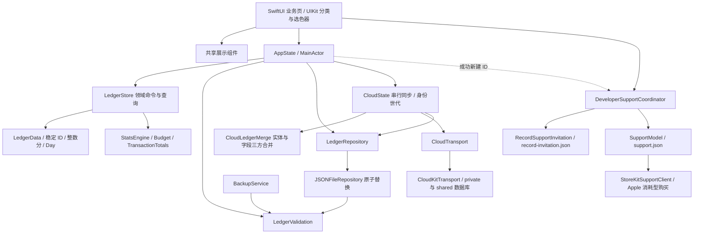

# 余记架构与扩展指南

更新：2026-10-16。包含可选 CloudKit 同步、共享及昵称；Production 双账号财务异常与记录归属已有证据，昵称离线/同账号设备、最低系统及最终发布仍分别验收，详见 [当前发布验证](release-validation-2026-10-15/README.md)。

新增 `CloudSnapshotComparison` 是纯只读领域投影，按实体 ID、业务字段与预算范围/生效期比较；不参与合并、写入或冲突解决，UI 只分页呈现差异。`CloudPeopleState.nicknameReadOnlyBooks` 复用当前账号云绑定判定展示影响范围，权限来源仍为 CloudKit。统计记账人筛选仍由 StatsView 单点持有，标题生成逻辑复用，明细通过清除闭包更新同一状态。预算组件只改变展开态，不复制计算规则。

支付 SDK 固定 `97f38bb1b9aa31cae0f469a58a37e1641aa8870f`。`SupportOffer` 包含可选数值价格/国家用于付款前一致性检查；`SupportReceipt.quotedOffer` 为当次选择的本地附属诊断，不是 Apple 签名字段，既有 schema 1 可兼容读取。实际金额/币种仍来自验签交易，缺证据返回未知；不自动改币种、重付或增加服务端。见 [本轮交付](release-validation-2026-10-15/build13-polish.md)。

最新问题、修复与证据见 [2026-10-08 复审](review-fix-2026-10-08/README.md)。保持现有分层；统一当前余额的业务截止日、sheet 主题根和中断草稿，量化长期数据查询成本。[10 月 3 日问题](release-audit-2026-10-03/findings.md)为历史基线。

## 1. 层次与依赖

`YujiCore` 仅依赖 Foundation。原生目标依赖本地 Swift Package 和私有 `DMLayMan/ios-base`；后者通过 SSH 固定支付修复提交 `aaa646c95d472243507c3c1062d6eb77f25ada74`（组件 [PR #4](https://github.com/DMLayMan/ios-base/pull/4)，尚未合并）；远端解析与源码一致性已核对，消费 `DeveloperSupportKit` 的付款模型与 UI，并仅使用 `EngagementPromptKit` 的 UI。没有引入支持后端、订阅、功能权益或分析 SDK，不使用 `EngagementStore` 的时间门槛。UIKit 用于分类按行分页与原生挪位、系统选色器、分享，以及核对自动邀请前的实际呈现/键盘状态。不要为复用引入与领域无关的通用表单引擎。

## 2. 状态归属

| 状态 | 唯一持有者 | 生命周期/写入方式 |
| --- | --- | --- |
| 账本、账户、分类、交易、预算、草稿、外观 | `LedgerData`，由 `LedgerStore` 持有 | 整体快照持久化；外部模块只读 data |
| 当前账本 | `LedgerData.activeLedgerID`；AppState 发布镜像 | `switchLedger` 经统一保存，重启恢复 |
| 流水与统计期间 | `AppState.browsingPeriod` | 会话状态；切账本回本月；不写 JSON |
| 今天 | `AppState.today` + 注入 dayProvider | 系统跨日/回前台刷新；测试冻结 |
| 所在 Tab/录入 sheet | RootView | 会话状态；正中 Tab 是动作 |
| 统计分类、排行顺序、明细展示上限 | CategoryAnalysisView | 同页局部状态；账本/期间 key 重建 |
| 未提交分类/预算/账户表单 | 页面 @State / Binding | 用户点保存后才变更领域 |
| 新建交易输入/草稿检查点 | EntryView / LedgerData.drafts | 关闭或后台比较最后落盘内容；编辑原记录不写新建草稿 |
| 文字焦点/键盘/退出确认 | 当前表单 | 生命周期内，不进领域模型 |
| 排序过程与分页 | InlineCategoryStrip.Coordinator | UIKit 本地变化，手势结束一次提交 ID 排列 |
| 保存失败/恢复阻断/撤销 | AppState | 统一发布；失败不冒充成功 |
| 云缓存/共同祖先/冲突版本/本机待传差异 | LedgerData.cloudLinks | 同一个原子文件；账号确认前隐藏，不能靠内存队列保证重启恢复 |
| 系统云身份/同步忙状态/异步世代/防抖 | AppState + CloudState | MainActor；所有网络返回先核对身份世代，账号改变取消防抖 |
| 私有邀请/成员权限 | CloudKit CKShare | Apple 为授权来源；客户端控件隐藏不是安全边界 |
| 支持呈现/安全时机/邀请到支持页切换 | `DeveloperSupportCoordinator`，YujiApp 的单个 StateObject | 仅前台协调；RootView 用同一个 yujiSheet 呈现 |
| 付款收据/当次购买阶段 | 单个 `SupportModel` | 稳定独立目录 `Application Support/YujiDeveloperSupport/support.json`；不进入 LedgerData、备份或云账本 |
| 新确认感谢/后台等待提示 | SupportModel.lastPresentationCompletion → YujiApp → DeveloperSupportCoordinator | 验签并落盘后一次运行期事件；先关闭支持页，onDismiss 显示原页面提示；前台后恢复，无历史重放 |
| 首 100 个成功新建 ID/consumedAt | `RecordSupportInvitation` | 同目录 `record-invitation.json`，稳定 scope；原子写入，展示前消费 |

不要在 View 中写文件，不把 UI 临时筛选存成领域字段，也不要让两个根页面各自维护“当前期间”。业务页可计算格式和布局，不复制收支统计公式。

## 3. 领域模块

| 模块 | 责任 |
| --- | --- |
| Models / LedgerData | 稳定 ID、日期、交易、目录、schema、设置、领域错误 |
| LedgerStore | 账本/账户/交易命令、余额、删除恢复、幂等、批量、草稿 |
| LedgerStore+Categories | 两级分类和历史标签命令、排序置换、引用保护 |
| LedgerStore+Budgets | 月/年账本与分类预算规则提交、生效历史 |
| CategoryExperience / TagCatalog | 默认选择与目录查询；历史兼容 |
| LedgerBrowsing | 筛选、TransactionTotals、账本累计概览 |
| Stats / StatsExploration | 自然期间比较、分类构成、变化贡献、下钻交易 |
| Budget | 预算规则模型、解析、选取有效额度、预览与超额排序 |
| BrowsingPeriod | 本月/本年/固定月年/范围/全部；流水和统计截止差异 |
| Money / Calculator | 整数分、CNY 格式、十进制表达式和舍入 |
| Theme | 主题枚举、sRGB 对比与深浅色调节；无 UIKit 依赖 |
| LedgerValidation | 全库结构和关系完整性；本地读写、恢复共用 |
| Persistence / CSVExporter | JSON 原子保存、完整备份校验、表格安全转义 |
| CloudSync | 单账本传输模型、三方合并、账号缓存隔离、独立副本 ID 重映射 |

`LedgerStore.transaction(id)` 缓存 ID 到数组偏移，避免分类退款分析对每笔记录再次扫描全历史。`LedgerData.didSet` 在所有嵌套增删改及回滚时使索引失效；缓存不是另一份可写模型。分类预算按期间一次遍历净支出，同时累计父/叶规则，替换预览先排除原交易再加入输入。查询语义仍由 Core 统一定义；`CategoryAnalysisView` 每轮渲染只取一次明细结果。

`LedgerStore` 是带惰性索引的可变类，不提供并行读写保证。当前由 MainActor 的 AppState 使用；未来后台查询应传 `LedgerData` 值快照并建立独立实例，或由明确的 actor 串行持有，不把同一 Store 跨线程共享。

当前余额页面统一调用 `AppState.currentBalance`，明确传入 `today`；未来记账起点的期初为零。领域可查询不同截止日期，不把“流水允许看未来”复用为“当前余额包含未来”。

补记恢复复用 `AccountEditForm`：管理入口 `AccountEditView` 只负责 NavigationStack/弹层表面，记账入口由父导航推入表单并传 `proposedStartDay`。父 `EntryView` 持有金额、分类、备注、日期，不因账户表单保存/取消重建；领域仍拒绝早于账户起点的流水。账户编辑通过同一 `AppState.perform` 原子保存、权限检查和回滚，不另建绕过校验的便捷写入。完整年份说明用 `Text(verbatim:)`，防止本地化数字插值插入千分位。数字键盘固定高度内的图标/动作标题采用可容纳的字号，表单正文继续跟随动态字号；深色验收必须使用应用内外观选择并截图确认。

没有机械地为每个页面新建 Store 或 ViewModel。现有体量用一个 MainActor 状态入口，按领域职责拆扩展文件，减少重复控制流。批量操作内部先试运行/预检，再整批提交。

## 4. 写入、回滚与恢复

正常写入顺序：

1. `AppState.perform` 拒绝重复保存或存储阻断状态，保存旧 `LedgerData` 快照。
2. 执行一个或多个领域命令；领域局部条件不满足则抛可解释错误。
3. `CloudWorkspace.checkMutation` 校验云账本身份、冲突与读写权限；标记变更作者并更新缓存待传差异；`LedgerValidation.validate` 校验整个结果，不允许页面组合命令留下悬空引用。
4. `LedgerRepository.save`；JSON 实现再次校验作为独立边界，编码到同目录唯一临时文件，再 replace/move。
5. 成功更新发布状态/提示；失败恢复旧 Store 与当前账本，表单只有 true 才 dismiss。

JSON 双重验证有意保留：AppState 支持注入其他仓储，JSON 也能独立使用。500 条数据规模成本已在回归中观察；以后性能数据证明瓶颈再合并验证凭证，不能直接移除完整性边界。

读取错误不自动改名或覆盖原文件，不写“已隔离”但忽略实际移动失败。`storageFailure` 阻止常规写入/导出；RootView 进入恢复页，可重试。恢复备份始终先校验：正常库保存完整恢复点；损坏库先复制原始文件字节；副本保存失败则不替换。新主文件保存成功后才替换内存。恢复点目录与当前文件同级，名为 `<filename>.restore-points`。

`AppState.recoveryPoints` 只枚举受管理目录中符合命名契约的普通文件，每个 URL 与目录均规范化路径别名。删除校验文件确属枚举结果；若为最新点，先落盘清除其引用，保存失败不得删副本。`RecoveryPointsView` 只发出明确单项操作；有效副本复用 `RestorePreview.validated`，不可读字节不能用于恢复。该文件能力不属于通用 `LedgerRepository` 契约，未来云仓储须另设计。系统分享退出只清理本次导出的 UUID 临时目录。

原子文件替换保护完整文件可见性，不声明断电场景下硬件持久性或多进程并发协调已经验证。当前是单进程 MainActor 写入；不能让未来 Widget、扩展或云同步各自直接保存同一个 JSON 文件。

## 5. 数据契约与兼容

当前 schema 为 4，读取支持已定义的 1～4 数据布局；云绑定和交易作者为可选字段，旧 1～3 文件保持兼容，保存升级至 4。`JSONEncoder` 使用 ISO8601 时间、稳定排序键；内部快照紧凑编码，外部备份保持可读缩进，读取格式兼容。交易金额是正整数分，类型决定影响方向；退款使用独立交易并引用原支出。交易稳定 ID 与 operationID 不因编辑改变；软删除不移除记录。导入时检查 ID 唯一、operationID 唯一、revision 合法。

归档实体是合法历史引用。新增交易可用性校验与全库历史完整性不能混为一套：若用“当前可选”校验所有历史，会使归档目录后的备份无法恢复。相反，损坏备份中的跨账本引用、非法日期、无原支出退款、重复预算规则不能通过。

金额合计用溢出检查设定安全边界，校验必须先于备份合计计算，避免构造数据引发 Int64 溢出。日期使用当前时区下公历日历，不受用户选择其他日历制导致年份变化；交易日期作为 Day 保持业务日不随展示格式转换。

旧 tagIDs 保留于历史、兼容分析与备份，不再有标签编辑/选择页面。删除未调用的原生 TagPicker 和 CategoryChip，保留历史领域模型/测试。新需求不得复活第二套分类概念。

备份 checksum 是数量与收支合计核对，不是加密摘要。备份去除云绑定和其他账号隐藏缓存，仅导出当前可见业务数据；恢复替换为本地库，不自动连接原共享或上传覆盖云端。不从 CSV 重建完整关系。替换前恢复点可以含原始云缓存，恢复解析仍移除绑定。

## 6. 共享组件契约

| 组件 | 输入/输出与复用范围 |
| --- | --- |
| PeriodNavigation + PeriodPicker | Binding<BrowsingPeriod>、today、日期边界、ID 前缀；流水/统计共用完整头部，无页面样式分支 |
| TransactionRow | 交易、是否显示日期；从环境只读目录/主题；流水、统计共用 |
| LedgerFormatting / StatsRangeLabel | 整数分/Day/范围/比较状态 → 统一文本；含明确舍入的保存文案 |
| CategorySymbol | CategoryNode 或旧名称 → 本地白名单 SF Symbol，失败回退通用图标 |
| InlineCategoryStrip | 目录 ID、当前选中、主题、排序回调；UIKit 不直接持久化或计算推荐 |
| CategoryEditorView | 同一个新增/编辑表单；领域保存成功返回 ID，调用方决定选择该分类 |
| BudgetFields / LedgerBudgetEditor | 账本+分类规则统一编辑；只有提交时写入。宿主持有 BudgetInputField 焦点 Binding，完成栏/提交按钮由同一焦点决定 |
| StatsBudgetView / EntryBudgetHint / CategoryBudgetSummary | Stats/Entry 公用预算解释，入参显式携带期间/截止/预览 |
| AmountText / SolidActionStyle / CleanSheetSurface | 统一数字适配、主按钮、表面与深浅色 |
| FormExitGuard | isDirty + requested；页内继续/放弃，页面负责先收键盘 |
| KeyboardCompletionBar | 表单持有可见性/焦点；safeAreaInset 内完成输入，子表单与退出决策互斥，不使用系统附件栏 |
| ThemeSettingsSections / AppAccentModifier / yujiSheet | 外观设置入口、根页与每个呈现根解析强调色；UIKit 分享和选色器显式使用同色 |
| PrivacyPolicyView / HelpView | 从随包 Markdown 读取离线政策；原生帮助与公开反馈入口 |
| YujiDeveloperSupportSheet / DeveloperSupportSheet | 独立 SupportModel + 宿主解析后的 SupportAppearance；手动与邀请均进入同一支持页 |
| EngagementPromptView | 只消费 PromptSkin、接受与关闭回调；100 笔计数和一次消费由宿主负责 |

分类拖动的 CADisplayLink 会持有 Coordinator；`dismantleUIView` 显式取消移动并释放刷新回调，不能只依赖 deinit。异步 UI 回调使用弱引用，页面销毁后不继续修改旧集合。

共享不等于所有表单完全相同：新建录入关闭保留草稿、修改记录取消需确认、预算编辑暂存、备份恢复替换确认是不同语义。不要抽成只有一个布尔“保存/退出”的通用组件而丢失区别。

预算输入不监听全局 keyboardWillShow/Hide 通知来驱动父页面布局。账本名称、月额度、年额度统一由宿主枚举焦点管理；进入规则子页先结束父焦点。全局键盘事件不能说明“当前表单正在编辑”，否则子页键盘会改变父页状态。其他表单的完成栏同样由自身焦点决定。

### 自愿支持与记录邀请边界

`YujiApp` 生命周期只创建一个 `DeveloperSupportCoordinator`，它持有单个 `SupportModel` 与 `RecordSupportInvitation`。挂接 `AppState.onRecordCreated` 后，只有 `addExpense`（收入/支出）、`addRefund`、`addTransfer` 的 `perform` 成功并完成账本落盘才发送稳定 ID。编辑、删除/恢复、重载、导入/备份恢复和云拉取走通用提交，不发送该事件；不扫描历史库存，不按账本分开计数。

邀请日志 schema 1、scope `com.yuji.app/record-support-invitation`，保存前 100 个不同 ID 的集合和可选 `consumedAt`。重复事件不写入；计数到 100 后等待安全时机，先检查支持收据、获取可用商品，已支持者消费邀请而不呈现。前台、无存储/错误阻断、保存结束、无云加入邀请、真实 root 无 presentedViewController/转场且键盘已退出才可展示。邀请先原子消费，成功才发布 presentation；接受后利用 dismiss 回调等第一层退出再打开支持页。后台取消呈现任务，任务 ID 防止旧任务清掉新任务。

付款日志 scope `com.yuji.app/developer-support` 与文件路径保持。每次进入清空上次选择并获取当前 Storefront 商品；价格/币种/地区变化需重新主动确认。付款前验证存储可写；验签后按 environment + transactionID 去重、原子记录再 finish。schema 1 兼容旧 receipts，忽略旧 unresolvedProduct，不通过历史标记阻断入口。新可选 purchaseAttemptID 由随机 UUID 与 Apple 回传值关联；lastCompletion 是通用收据事件，宿主仅监听 lastPresentationCompletion 关闭当前支持页并感谢。历史 unfinished/updates 静默核验，不结束新一轮面板；只有当次核价/系统调用未完成时防连点，不因 pending/unknown 禁止用户主动下一笔。不自动重付，不写账本流水。

两个日志使用没有版本号的稳定目录；账本导出/恢复、切换、升级不会重置邀请。App 删除可清除它们，不能承诺消耗型购买在重装后恢复为永久权益。邀请坏文件/写失败保留原字节并停止自动邀请，付款坏文件保留状态并阻止冒充未付；都不能回滚成功账单。账本与邀请不是跨文件事务，账本已保存而邀请日志尚未保存时进程退出可能少计一笔。DEBUG 只有合法 UUID 隔离会话才使用临时目录、模拟客户端或本地 StoreKit；正式目录不受测试影响。

## 7. 后续扩展步骤

### 新增统计维度或图表

先明确分母、退款归属、截止日期、空/负/零状态；在 Core 增加纯查询与守恒测试；UI 复用 PeriodNavigation、TransactionRow、同页筛选状态。明细取数和主指标必须使用相同过滤口径。不能创建单独日期状态或复制收益计算。

### 新增领域字段或交易类型

修改 Codable 默认解码、共享校验、命令、备份/CSV、金额聚合与迁移测试；保持稳定 ID。新增交易类型需穷举账户影响、统计、预算、退款/删除、显示语义。schema 变更必须附旧数据恢复用例，不在 View 中修补导入数据。

### 新增主题或分类图标

主题扩展 `AccentTheme` 和对比测试，UIKit 只消费统一已解析颜色。图标扩展 `CategoryIcon` 白名单并跑原生符号可用性测试。不要用每次进程变化的 Swift hashValue 为分类配色；图表已有稳定字符串映射。

### 可选 iCloud/多人共享

`CloudTransport` 将领域同步与 CloudKit SDK 分开，可注入共享模拟服务器自测。真实适配访问 private/shared 数据库，一个账本一个自定义 zone、一个 `YujiLedger/ledger` 根记录，业务快照以 CKAsset 条件原子提交。CKRecord 系统字段保存版本凭据，`.ifServerRecordUnchanged` 拒绝覆盖别人的更新；最多三次重新读取/合并重试，不按设备时间最后写入获胜。元数据轮询只读取版本，未变化时复用已校验资产；共享权限仍向 CKShare 刷新。此传输是逐账本资产，并非逐实体网络增量；40 MB 上限和长历史流量/主线程成本须实测，未来可替换适配保留领域契约。

合并先按稳定实体 ID，再按独立字段；预算按周期/生效点/分类范围合并。同一金额修改、删除对编辑、重复同层分类名及合并后退款超额进入冲突，非法结果不上传。缓存与共同祖先差异构成持久待传状态，业务与同步元数据同次落盘。网络等待期间的新增本机修改再次合并，不能因收到旧确认而清掉。重试用稳定 ID，不重复生成交易。

身份为容器 + Development/Production 环境 + 系统用户记录 ID，地址另含 private/shared、zone/owner。启动先隐藏所有云账本缓存，AppState.startupCloudSelection 暂存持久文件中该账号的当前云账本；身份核对相同后恢复选择，用户主动切账本或账号失效即清除此临时意图，不修改数据 schema。再激活确认的账号；账号变化用 epoch 防止旧回复落入新身份。缓存绑定以账号 + 账本 ID/地址唯一，同一本共享账本允许两个账号各存一份。`activeCloudAccountID` 表明可见云业务数据的所属账号，捕获和统一变更校验只处理该账号，不能把可见账本快照写进其他账号的同 ID 缓存。独立本地账本不被隐藏。账号暂不可用停止云请求，保留已确认缓存；读写权限由 Apple 对真实请求最终授权，离线撤权需联网才能得知。

首次开启同步先检查同源云 ID；恢复后的本地账本不能直接在第二个 zone 重复原身份。发现同源时界面要求确认独立副本，保存重映射 ID 的新账本并启用，原本地和原共同账本均保留。初次开启需要联网，已经开启的账本仍可离线记账。

冲突处理先保存重映射全部 ID 的独立本地副本，再采用云端；旧草稿引用已删目录时保留 unresolvedDraft，复制时清除失效引用而保留金额和备注。参与者退出与同步使用同一 busy 通道，先保存副本，再解除共享成员关系，成功后移除云绑定并回本地账本。邀请由 CloudMemberInviteView → CloudKitTransport.invite：验证邮箱与当前拥有者，按邮箱查找参与者，设置只读/读写并保存 private CKShare，保存成功后才复制链接。重复参与者不新增，权限变化引导系统成员管理；无额外账号库或后端。移除/改权限/停止共享仍用 UICloudSharingController。SwiftUI 应用/场景代理接收冷启动和运行中邀请；真实路由验收见 [双账号记录](icloud-delivery-2026-10-08/dual-account-acceptance-2026-10-14.md)。

参与者退出的 CloudKit 操作必须在 shared database 删除该 zone 的 `CKRecordNameZoneWideShare` 记录，不能删除 owner 的 record zone；private 地址由适配器拒绝。成功后失效下载缓存。2026-10-16 真实服务曾拒绝旧 `deleteRecordZone` 调用，修复与退出/重邀回归见 [续验记录](release-validation-2026-10-15/cloud-resume-2026-10-16.md)。模拟传输层成功不能代替真实 Apple API 语义验证。

全局 yujiSheet 和 overlay 外层注入 AppState/DeveloperSupportCoordinator；只给 RootView 内层注入会导致邀请 sheet 的 PresentationTheme 缺失环境对象并崩溃。接受期间禁止交互退出，账号 epoch 变化不继续切账本；等待已有同步通道释放后拉取，并检查下载/同步结果，定位保存失败保持确认页。

`YUJI_CLOUDKIT_ENABLED=NO` 为默认；有正式容器、签名 entitlement 才构造 CKContainer。AppSettings 旧 icloudEnabled 不参与连接判断。Debug 模拟适配还须合法隔离 UUID，界面明确标注模拟，不进入 Release。配置与真实验收表见 [当前交付](icloud-delivery-2026-10-08/README.md)，不是历史 CKSyncEngine 提案。

### 扩大数据量或支持后台写入

现有确定性 500 条交互夹具及 5k/50k 优化编译基准分别验证行为和查询复杂度，见[复审记录](review-fix-2026-10-08/README.md)。Mac 热身后查询结果不能外推成真机流畅；5 万条完整快照保存/读取仍约 430/460ms。后续先测真机主线程和内存，再评估 SQLite/SwiftData 与 actor 仓储。新增异步写入必须有有序提交、版本保护、取消与失败回滚，不能仅在后台队列调用当前同步方法。

## 8. 测试与交付

macOS Swift Package 复用同一个 AppState 文件，并排除 `YujiTests/Native` 目录中的 UIKit 测试；iOS 单元目标包含真实 UIKit 渲染检查。新加 UIKit 测试放入 Native 目录，避免纳入 macOS portable target。

`PrivacyInfo.xcprivacy` 由 iOS App 打包，macOS 的 AppState target 显式排除，避免未处理资源警告。用户已确认 App 最低 iOS 17，`project.yml` 中 App 和两个原生测试目标均声明 17；归档/导出包的 `MinimumOSVersion` 已核对为 17.0。原生运行覆盖 Pro iOS 27 与 SE iOS 26.5 模拟器；iPhone 12 / iOS 26.6.1 已完成开发签名及真实 Sandbox 交易、Development 双账号核心共享回收。10 月 15 日 1.0 (4) 正式分发包已签名导出并上传、Schema 已部署 Production；真正 iOS 17 运行、Production 真实服务、TestFlight 安装和上架仍为独立门槛，见 [最新发布验证](release-validation-2026-10-15/README.md)。

工程配置：Debug 默认关闭云适配；Release 默认 `YUJI_CLOUDKIT_ENABLED=YES`、Production 并引用 `Yuji/Cloud/Yuji.entitlements`。数据仍逐账本由用户主动开启同步，不能用关闭发布包能力实现“默认本地”。本地实验包可显式覆盖云开关为 NO。Development/Production 属于不同缓存身份，升级体验包前先导出业务备份；恢复去掉旧绑定，再由用户选择是否启用生产同步，不自动复制测试共享权限或上传到另一环境。

`TestSupport.useIsolatedFixture` 为每个 UI 测试生成 UUID，冻结业务日；重启测试复用同一个 UUID。`scripts/regress.sh` 给 hosted unit test 也注入隔离路径，并使用每次运行独立 manifest，不触碰个人账本。仅 DEBUG 且 UUID 合法时启用；显式测试参数非法则拒绝启动，不回退个人仓储。正式构建走默认仓储。

回归入口使用 Node 校验 only-testing/skip-testing 选择对应的真实目标、类和方法，防止 Xcode 静默忽略不存在的用例。汇总按用例身份保留最新结果与来源；完整失败批次仍在 evidence 中，不把重复运行次数当成覆盖数量。运行中不能改正在读取的 shell 脚本或重建同一 derivedData。

优先审查所有保存调用点是否检查成功、日期/金额/分类是否共用规则、状态修改是否经 perform。测试结果、原生截图和已知边界见[回归记录](regression-2026-09-11.md)。发布仍需要真实签名、隐私/图标/商店材料和目标设备验收。

Release 必须检查真实 archive：有效 AppIcon、随包政策、zh-Hans、本地存储能力说明，且排除 `stats-500.json`。Debug 夹具能隔离不等于 Release 资源自动消失。2026-10-13 新签名候选包为 1.0 (1)、com.dmlayman.yuji，匹配指定团队和新容器；App Store 本地导出不证明平台上传、升级或审核通过。商品 ID 和日志 scope 是独立稳定契约，保留旧 com.yuji.app 前缀，不因 Bundle ID 变更整体替换。

支持能力用 `RecordSupportInvitationTests` 验证新建事件、持久门槛和坏文件/写失败隔离，`DeveloperSupportUITests` 核对手动/自动动线、StoreKit 本地购买与审批、注入取消/未决、主题/大字/小屏。`YujiSupport.storekit` 通过 XcodeGen `sources` 的 `buildPhase: resources` 放入 UI 测试包；不是正式商品配置。当前批次、最后颜色修改的重跑状态、真实 Sandbox 与 App Store 条件见 [支持交付记录](developer-support-2026-10-08/README.md)。

### 2026-10-15 外部邀请呈现边界

外部共享触发全局 sheet 曾在 PresentationTheme 读取缺失的 AppState 时崩溃。两种 `yujiSheet` 的 ViewModifier 在呈现侧 body 中捕获 AppState，交给 `ThemedPresentationRoot`；后者观察同一实例、解析主题/locale、向弹层内容重新注入对象。不能以 fallback 空 AppState 掩盖依赖错误。三条原生测试覆盖无外部环境的根及 bool/item 冷呈现；真实接收与发布包另验。见[崩溃复审](release-validation-2026-10-15/sharing-presentation-crash.md)。

## 2026-10-15：账号昵称元数据

统计人维度通过 `StatsEngine.AuthorFilter`（all/person/unknown）实现，默认 all 保持其他调用方不变。统一 `active` 入口被 summary、分类聚合和分类明细复用，同比环比及年趋势继承同一个引擎；禁止仅在 SwiftUI 明细列表过滤。StatsView 持有选择并传给 CategoryAnalysisView；身份按 authorID，昵称只用于展示。整账本预算不接受人员过滤。退款过滤退款自身作者，但查询原记录分类时不受人员条件限制。

CloudPerson 是展示资料，CloudPeople 是账号隔离的本机缓存/outbox。CloudPeopleState 处理 revision/epoch 防陈旧回写和解析，CloudKitPeople 负责私有全局记录及共享 zone 中的独立成员投影，CloudTransport 提供兼容的默认能力接口。财务 CloudLedgerSnapshot 格式 1 不变，备份排除待发送昵称。细节及只读限制见 [决策与验收](shared-nickname-2026-10-15/README.md)。

CloudKit 真实服务补充：参与者当前用户的 CKCurrentUserDefaultName 必须规范到 container.userRecordID 对应的账号身份；昵称投影、成员展示与邀请自己判断复用此转换。见 [构建 8 实证](shared-nickname-2026-10-15/live-testflight8.md)。

## 2026-10-15：价格透明与测试环境边界

用户实际体验构建 9 后明确撤回“隐藏金额／去 App Store 确认”方案。支持页必须在主动购买前展示每档金额和币种，视觉与无障碍文案一致；默认不选，选中后按钮为“请一杯 · 金额”，仍在 App 内拉起 Apple 原生购买确认。不能通过隐藏金额、硬改符号或猜测汇率掩盖目录异常。

余记宿主统一显式使用 `SupportPricePresentation.localized`，不再按分发收据隐藏价格，移除旧 Debug 确认模式开关。金额来自 `Product.displayPrice`，不添加客户端价目表；当次目录复核、交易验签与收据持久化、重复支持和关闭重开保留。公共 SDK 的可选模式仍存在，但余记不调用。

恢复价格展示不代表美元问题修复。已安装构建 9 保留原行为，只作历史测试产物，不能用于送审；本地修改尚未分发。真实 TestFlight 商品报价与系统页/交易币种的一致性继续作为独立未关闭门槛，见 [价格方案撤回记录](release-validation-2026-10-15/price-transparency.md)。

## 2026-10-16：无障碍基础组件边界

`View.minimumTouchTarget()` 作用于控件 label 内部；单纯外层 frame 仅改变布局，不作为命中区证据。`Design.secondary` 为 SwiftUI 的主要辅助文字提供浅/深色不透明颜色，比例由 SwiftUI `Color.resolve(in:)` 在指定浅/深色 EnvironmentValues 中解析后测试。iOS 17 上先桥接 UIColor 可能冻结当前外观，不能据此误判深色 token。

`TransactionRow` 统一视觉行与整条朗读句，`CategorySymbol.accessibilityName` 统一分类编辑和云差异的中文图标名，`spokenDayText` 与 `StatsRangeLabel` 保留完整年月日读屏语义。不得在流水/统计各自复制一套金额、作者或日期口径。显示字符与辅助技术标签允许不同，UI 测试应断言完整业务含义，而非强制英文 SF Symbol 或单一标点。

`FormExitGuard` 与记账的草稿确认分别管理自己的焦点请求和非活动表单隐藏；不新增全局焦点协调器。XCTest 审计、颜色比例、真实尺寸与动态字号回归是不同门槛，均不能替代物理设备 VoiceOver。详见 [专项验收](release-validation-2026-10-15/ios17-accessibility-2026-10-16.md)。
