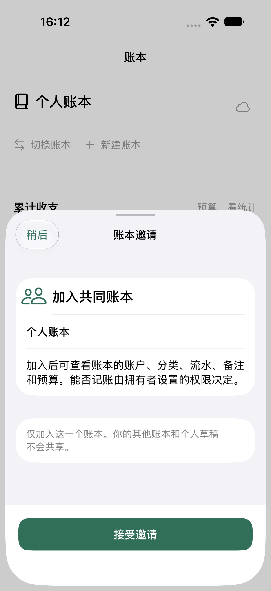
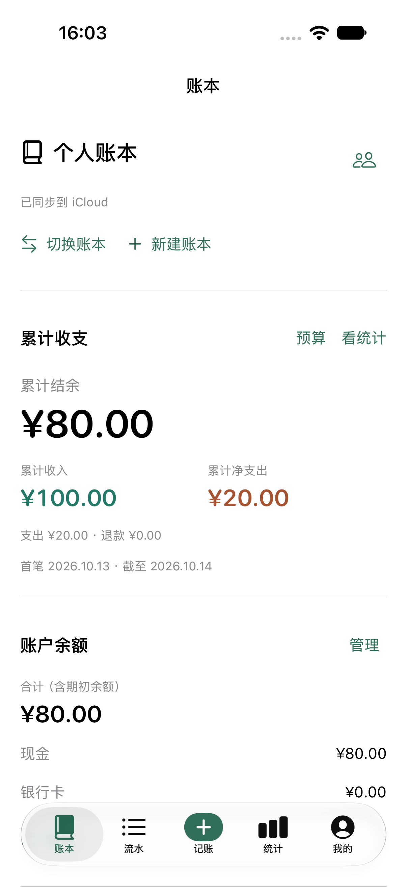

# 真实双账号共享验收 · 2026-10-14

环境：1.0 (3) Debug，`com.dmlayman.yuji` / `iCloud.com.dmlayman.yuji`，CloudKit **Development**。A 为 iPhone 12 / iOS 26.6.1；B 为独立 iPhone 18 Pro / iOS 27 模拟器。用户本人登录；实时 CloudKit 身份已核对不同。未切换当前 Mac 用户或当前 Mac/iPhone 的 iCloud，发布身份保持指定账号。邮箱、私有链接、用户记录 ID、个人账本只留在忽略的 evidence，文档不记录这些值。

## 结果与边界

| 路径 | 当前结果 | 证据 |
| --- | --- | --- |
| A 指定成员、一起记账、生成私有邀请 | 已通过真实 App 表单及 CKShare 回读；2 人，受邀人先 pending | `invite-recipient-ui.xcresult`、`private-share-after-invite.json` |
| B 运行中打开链接、系统确认、App 接受、下载定位 | 已通过；下载 A 的原支出 ¥12.34 | `b-warm-accepted.png`、B 隔离文件 |
| B 重启后仍定位共享账本，新增 ¥7.66 | 修复启动选择后通过原生 UI；A 收到累计 ¥20 | `b-shared-write-fixed.xcresult`、A 读回证据 |
| A 新增收入 ¥100，B 重启后拉取 | UI 已完成保存，真机中途断连导致测试整体失败；重连回读与 B 原生通过确认保存、上传及接收 | `a-read-b-write-income-fixed.xcresult`（保留失败）、`a-after-income-attempt.json`、`b-read-a-relaunch.xcresult` |
| 两端财务及同步状态 | 3 笔，收入 10000 分、支出 2000 分、结余 8000 分；业务记录完全相同，cached=base，两个作者，无冲突 | `convergence-summary.json` |
| 只读、恢复可编辑、撤权 | 已通过；A 用真实 SDK 修改指定成员权限，B UI 刷新后阻止/恢复记账；撤权后保留 3 笔、结余 ¥80，禁止新增 | `a-set-readOnly-lookup` / `a-set-readWrite-lookup` / `a-revoke-b` 和各自 B 原生结果包；系统改权限 UI 本身尚未逐项走完 |
| 冷启动与重复邀请 | 已通过独立真实系统 URL；冷启动 B 的空正常仓储首次下载 3 笔，热启动重复接受后仍 1 个共享实例；重复指定成员后仍 2 人、1 位已接受 | 最新 `b-final-external-cold.xcresult`、`b-final-external-warm.xcresult` 断言弹层真正关闭和已同步；初次下载见 `external-invitation-summary.json`、`a-duplicate-recipient.xcresult`、`private-share-after-acceptance.json` |
| 正常个人账本字节保护 | 本批次原始文件与最终共享/支付观察后的回读逐字节相同；测试账本仍 3 笔且 cached=base | `final-protection-and-sandbox-summary.json` |
| 撤权后重新邀请恢复 | 已通过重新指定成员、系统再次确认、接受及可编辑恢复；A 回读仍 2 人/1 已接受，B 无问题、可编辑、3 笔 | `b-reaccept-restored-v2.xcresult`、`b-confirm-restored-write.xcresult`、`a-final-share-summary.json`、`b-final-restored-summary.json`；最终关闭断言见冷/热批次 |
| Production / TestFlight | 未部署 Production schema，未提交 App Store；Development 不等于发布通过 | 独立发布门槛 |

原始证据位于 Git 忽略的 `evidence/dual-account-20261014/`。A/B 的保存、新增与重启使用显式隔离 UUID；不设置模拟云环境。普通回归不会执行这里的 opt-in 用例。冷启动系统链接不继承进程环境，若验收该路径，只可使用 B 的空正常仓储并单独留证，不能对真实 A 个人账本采用同样办法。

## 已确认的产品问题

| 问题 | 原因、修正及防回归 |
| --- | --- |
| 拷贝私有链接后 B 提示无权限 | 链接存在但 CKShare 未增加指定参与者。新增邀请表单，官方邮箱查找 → 设置权限 → 保存 private share → 复制/分享；公开权限始终 none |
| 打开真实邀请后 App 崩溃 | 全局 sheet 的 PresentationTheme 无 AppState 环境对象；依赖只注入了 RootView 内层。把依赖置于全局展示树外层，真实热启动重新接受通过 |
| 重启后共享账本变成空的本地账本 | 启动隐藏云缓存时丢失当前选择。暂存原账号/账本意图，身份一致后恢复；主动切账本或账号失效取消意图。红测先失败，修复后单测和真实 B 重启通过 |
| 重新读取文件后，同一账号的云账本无法激活 | 只比较运行时账号 ID，忽略磁盘重读已隐藏可见缓存。刷新同时核对 activeCloudAccountID；新增红测复现并通过，重新核对同一身份后才重新激活 |

接受邀请同时补强账号 epoch 防护、账本定位保存失败反馈和接受期间退出约束。等待正在运行的同步通道释放后再拉取，最多等 30 秒；未完成下载/存在同步问题时保留确认页和重试，不用旧缓存冒充成功。邀请与接受复用七分屏/大屏主题、系统字号、底部主要动作；邀请邮箱键盘完成栏与提交栏互斥。默认态和冷启动接受页已经实际查看。

## 手工确认后的新增回收

新版支付用户确认正常，正常目录有新已核实 Sandbox 收据 ¥6/CNY，隔离目录保持原先收据。正常启动同时自动发现同账号 Development 的验收账本；正常库由原 1 本/1 笔变为 2 本/4 笔，新增 3 笔恰为已知验收夹具。原有全部业务实体、设置及账本选择未变，不能继续宣称这次完整文件字节未变。备份和精确预览通过后，用户授权清理；真实 zone 删除及其他 zone 不变已核验，A/B 目标缓存已回收。正常启动后 A 1 本/1 笔、B 1 本/0 笔，原用户数据、设置、其他云绑定和新支付收据保留。初次指纹拦截及最新三条清理用例见[清理记录](test-fixture-cleanup-2026-10-14.md)。

## 测试工具的经验

1. 先读取实际 xctestrun schema；本工程为 FormatVersion 1 根目标字典。没有执行任何测试不能标成失败产品场景，也不能记通过。
2. 系统 popover 可保留底层控件 hittable；断言下一阶段实际控件，不用底层不可点击作为唯一成功判据。
3. XCTest UI runner 无权读取真机 App 的通用剪贴板；用 App hosted SDK 回读同一个私有 share，UI 拷贝路径另验。不得因此放松私有权限。
4. 原生分类为 UICollectionView Cell，不是 Button；按真实 AX 类型/标识命中。金额未保存时的测试定位失败与产品故障分开记录。
5. `shareParticipant(forEmailAddress:)` 不保证 userRecordID 存在；用非空 ID 或 lookupInfo 邮箱匹配指定成员，不把两个 nil 当成相同身份。
6. 接受过的重复链接可直接进入 App；撤权后重新邀请会再次显示 Apple 的打开确认。测试同时等待目标 sheet 或当前 App/SpringBoard/ShareBear 的实际打开按钮，不假设提示永远归属固定进程。保留未识别弹窗造成的原始失败；不能记为产品拒绝邀请。根页旧数据在弹层背后仍存在，断言须先等待 cloud.accept 不再存在，再检查已同步及金额，否则会提前通过并在异步接受尚未完成时结束进程。
7. 真机失联时先回读是否提交成功；本次收入已保存并上传，不重跑新增，否则验收工具自己会制造重复账。
8. UUID 仅隔离本地仓储，不能隔离同账号的真实 Development 云 zone。测试账本应明确命名与登记，并在验收结束后按备份、确认、精确定位清理；后续不能以账本名称作为删除判据。
9. 不在运行中的派生构建目录重建；不并行迁移/读取同一个 xcresult。失败日志和结果包保留，修复用新的结果路径。

本轮最新 portable 测试 158 项通过（113 core + 45 AppState），共享选择及磁盘重读新增三项回归。原生针对性回归 33 项通过（19 CloudState + 3 邮箱 + 8 共享 UI + 3 本地支付 UI）；最后重读修正又在真机跑 23 项（20 CloudState + 3 邮箱），与前一批有重叠，不累加成独立覆盖。最终邀请防护在真实 B 冷/热启动重新通过，Release Production 配置编译通过但未签名。真实 Sandbox 自动观察先行超时；后续用户确认正常，正常目录新收据 Sandbox / ¥6 / CNY 已回读。人工支付路径通过，自动超时仍保留原结果。测试数量仅表示这些用例，不外推成完整真机或真实服务矩阵。

Apple 官方依据：[私有共享记录](https://developer.apple.com/documentation/cloudkit/shared-records)、[邮箱查找参与者](https://developer.apple.com/documentation/cloudkit/ckcontainer/shareparticipant(foremailaddress:))、[添加参与者](https://developer.apple.com/documentation/cloudkit/ckshare/addparticipant(_:))。最新整体范围见 [真实云回收表](real-cloud-acceptance.md)；支付仍以 [真实 Sandbox 记录](../support-payment-2026-10-14/README.md)为准。
