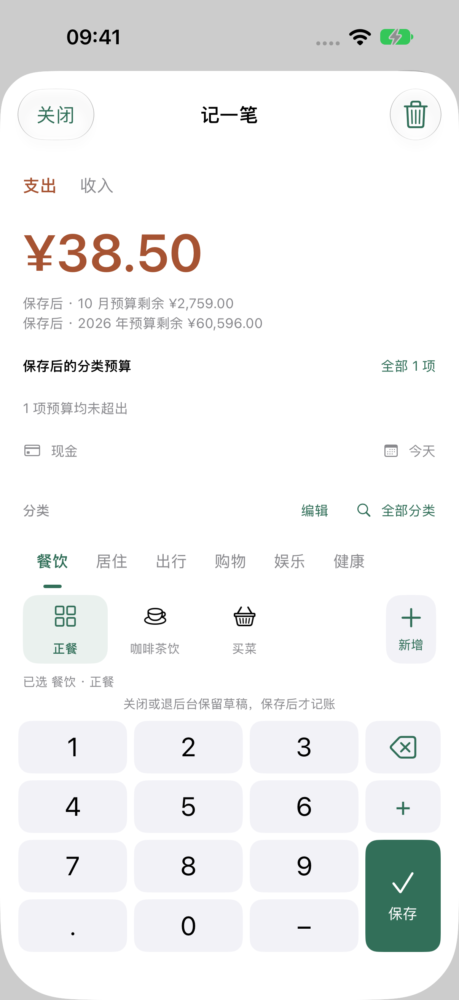
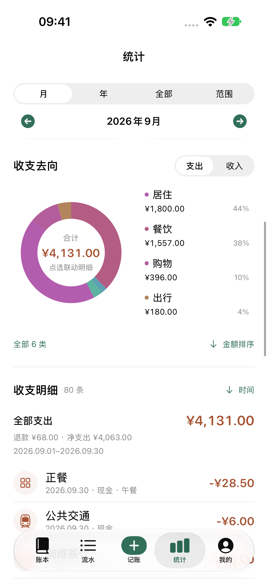

> 设计收尾：[最后一轮视觉与动线复审](../final-polish-2026-10-16/README.md)记录统计层级、流水备注、我的分组、账本大字及收支选中态的源代码修改和模拟器验证。这些改动尚未发布到 TestFlight；下面的构建 15 安装证据不能当作新 UI 的真机验收。

> 当前已安装：[TestFlight 构建 15](build15-reissue.md)已在 iPhone 12 覆盖安装，设备与帮助页核对通过。升级数据保护、真实 Production 同步、统计人员筛选与同页明细通过，测试后数据除同步时间外不变。15 与 14 产品源码一致（仅构建号不同），签名、资源、Production 配置和 CI 已通过。14 下载卡住根因仍未确定；本人暂时不方便听读，真机 VoiceOver 保留待验证，本次不再请求或占用手机。[iOS 17 与无障碍验证](ios17-accessibility-2026-10-16.md)保留实际已测范围和未关闭告警。商店草稿最近核对为 13，未提交审核；Apple 反馈与备案等待。

> 已安装基线：[TestFlight 1.0（13）](build13-polish.md) 已完成本地验证、签名导出、上传及原内部组分发回读。SDK 97f38bb，产品源码 e0a6cc2，App 草稿 PR #3；已回读 CI e54e9f8（run 38850819923）的 Core 与 iOS build 通过。13 与三档 IAP 已关联同一份四项审核草稿；五张新版截图、审核说明、手动发布刷新回读一致。13 真机升级和数据保留已通过；三档刷新后仍为 USD，[真实断网昵称及恢复](build13-live.md)已通过，真实价格一致性继续核对。备案等待，不提交 App Review。

> 历史安装基线为 [TestFlight 1.0（12）](build12-reissue.md)：手机实际安装和帮助页已核对；两项原生测试验证同步及按记账人筛选，10 项数据保护检查通过。审核草稿已关联 12 与三档 IAP，刷新回读为四项，保留手动发布，未提交 App Review。新版付费协议有效，备案等待。

上架卡点、验证缺口及功能体验优化顺序见 [2026-10-16 发布与体验复审](readiness-and-ux-2026-10-16.md)。该复审为只读检查与建议，未实施其中的 UI 改动。

> 历史过程（已由 12 安装结果覆盖）：[共享退出修复与构建 11](cloud-resume-2026-10-16.md)。新私有邀请接受、修复后的真实成员退出、本地副本与重新加入已通过；统计人员筛选实测通过。构建 11 已加入原 TestFlight 内部组，手机升级待核对。下方构建 10 的待重邀/退出描述为历史状态，以最新报告和 validation-status.json 为准。

# 10 月 15 日发布验证

> 历史构建 10：**1.0（10）已实际安装并核对**。真实云异常阶段与材料当前状态以 [本轮检查](cloud-final.md) 为准。构建 10 与三档 IAP 已组装为 4 项审核草稿，App Privacy 已获授权发布；新邀请接受、退出共享及 USD 目录异常尚未关闭，未提交 App Review。

## 历史：构建 10

[构建 10 交付与剩余问题](build10-delivery.md)：176 条 portable 通过；原生主回归 92 通过、9 专项跳过、0 失败；修复小屏最大字号长昵称布局后，最终 SE 4 / Pro 2 定向复验通过。最终签名归档、14 项资源门槛、上传及群组/说明刷新回读完成。当前设计见 PRD / UI-SPEC / ARCHITECTURE；机器可读状态见 [validation-status.json](validation-status.json)。

## 历史：构建 9（交互已撤回）

[金额确认兜底与本轮发布记录](build9-delivery.md)：SDK de43e66，1.0（9）已上传并实际安装；172 项 portable、原生 93 通过/9 专项跳过/0 失败、SDK Pro 11 与 SE 两项通过。隐藏金额方案随后被用户撤回，详见[撤回与修正记录](price-transparency.md)。旧测试仅证明当时实现。

以下为此前阶段记录；当前版本和待办以顶部构建 13 与 validation-status.json 为准。

18:28 最新：[TestFlight 1.0（8）与真实验收](../shared-nickname-2026-10-15/live-testflight8.md)已完成本轮 A/B 昵称目标。iPhone 已实际安装 8；真实 Production 双向改名、冷启动、新增归属及 B 编辑 A 后保留创建人通过，原昵称已恢复。原两笔不变，QA 最终 4 笔 ¥65.67；3 条收据逐字节相同，本机新建计数只增加 A 的一笔。B 为另一真实 Mac iCloud 的原生集成/服务回读，未使用模拟身份。归档、上传、模拟、真机和正式审核仍分开判断。

用户授权：修复补记，验证真实云异常与 Production/TestFlight，补齐发布材料；备案等待审核。未经最终确认不提交 App Review、不公开发布 App。仅两页静态隐私/支持站点另获明确发布授权。

## 历史阶段结论（构建 8 及更早）

**当前手机为 1.0（8），本轮昵称与归属目标通过；尚未提交 App Review。** 构建 8 固定 SDK 28969d1，包含已验证的支付等待说明，172 条 portable 与 SDK 44 条通过；签名归档/上传/实际安装证据及剩余限制以昵称交付记录为准。支付地区差异、公开隐私站点新增说明、SDK 远端 CI 计费拦截、备案等独立门槛仍需关闭。

以下构建 4–7 记录保留当时证据，不把旧包的测试或 IPA 签名结论套用到 8：

**1.0（7）已实际安装。进入/关闭重开通过；本人完成购买账号登录后整体链路恢复，两笔新Sandbox交易均已验签落盘，均为18/CNY，原收据、邀请和账本业务实体保留。价格展示仍未通过：登录后重新拉取和重开依然显示USD，和真实交易币种不一致。** 见 [构建7交付](build7-delivery.md)、[付款与价格取证](build7-iap-hang.md)、[Apple反馈草稿（未发送）](apple-storekit-feedback-draft.md)。SDK43条Swift＋7条原生StoreKit、宿主22条专项及根161条属于构建7本地基线；最新等待反馈在SDK本地补充，尚未进入TestFlight。

**1.0（6）已上传、处理并进入原内部群组，手机设备清单已确认实际安装 6，本人也已核对 App 内版本。** 构建 5 的下载任务持续异常，按本人要求仅把构建号改为 6 重新打包；111 个构建源文件/资源逐项对比，除构建号外相同。新归档及实际 App Store 导出 IPA 的签名、Production 容器、get-task-allow=false、发布资源均通过。说明与仅 1 位测试员的原“首发验收”群组保存后刷新回读、截图留存。新包实际 UI、云异常与支付仍继续验收，不能由安装成功推断功能全部通过。详见 [构建 6 重发](build6-reupload.md)。

共享闪退已修复并通过 Mac 的真实 Production 邀请接收；呈现侧捕获同一个 AppState，再显式传入和注入弹层根，3 条依赖原生测试通过。曾出现磁盘新文件对应内存旧进程，完整退出 QA 端并核对进程后才完成有效重验。详见 [崩溃与修复](sharing-presentation-crash.md)。

补记修复已有实际构建 4 证据；5/6 包含同一后续修复和 SDK 5a15573。Production schema 已部署。同一 QA 批次 A TestFlight 上传 ¥12.34，B 接受私有邀请后新增 ¥20.00，远端 2 笔 ¥32.34；A 连接失败时保留旧缓存并明确报错，随后实际恢复到相同数据，B 独立再回读一致。同步截图仍显示 Wi-Fi，所以只判定连接恢复，不判定纯蜂窝测试通过。**不同账号接收、B→A 新增与连接恢复、构建 6 的 A→B 原记录修改、只读写入拦截和恢复编辑权限回读均通过**。双端真实离线/并发、撤销重邀、恢复权限后重新写入仍未全部关闭。详见 [本轮恢复与安装核对](cellular-recovery.md)。

当前不满足送审条件。签名、上传、可安装、实际安装、Production 双账号服务、Sandbox 购买与最终审核是独立门槛。

继续操作见 [下一轮交接](next-run.md)，结构化状态见 [验证状态](validation-status.json)。私有 evidence 分别保存构建 5/6 的 111 个构建文件/资源快照及逐项哈希；App 工作树仍未提交，不能仅凭旧 Git HEAD 复现候选。

## 补记修复与界面

问题：新账户默认从当天开始，首笔昨日/去年记录被保存规则拦截，但记账页没有直接恢复路径。

新动线：选择早于账户起点的日期 → 就地展示账户与起点完整年月日 →「调整记账起点」→ 复用账户编辑表单并预填该笔日期 → 保存账户 → 返回保留金额、分类、日期与备注的原记账页 → 用户另行保存交易。

- 不静默迁移起点，不改变期初金额，不放松财务校验；解释期初生效日期随起点变化。
- 取消未修改的预填表单直接返回；修改后仍走既有退出保护。只读共享成员不可调整。
- `AccountEditForm` 复用管理与补记路径，调用方持有导航，避免 sheet 上叠 sheet。
- 完整日期用 `Text(verbatim:)`，避免年份变为 `2,026`。
- 固定高度数字键盘的删除图标与保存标题限制在按键内；金额、说明与账户表单仍支持动态字号。
- 两轮 SE 集中视觉检查：第一轮发现按键溢出及假深色参数，第二轮实际切换应用深色、最大字号重验通过。

## 较早构建 4–7 的验证矩阵

| 检查 | 当前证据与边界 |
| --- | --- |
| 领域与 AppState | `swift test` 161 通过（113 Core + 48 AppState），0 失败；跨年、零/非零期初、落盘失败回滚、历史边界、只读成员 |
| 当前完整原生回归 | 159 项：135 通过、24 显式专项跳过、0 失败，实际 xcodebuild 退出 0；包含共享呈现修复。24 项为 8 条云/清理原生、2 条商店截图、14 条真实云/Sandbox UI，独立专项另外留证。冻结二进制的 SDK 为 aaa646c，后续 5a15573 另由构建 5 的 21 条专项与归档覆盖，不能把两个版本结果相加冒充同一构建全测 |
| 最终 SE 专项 | 2 通过、0 失败；实际深色、最大动态字号、补记取消/调整/保存/重启；小屏说明与表单可滚动 |
| 真实 Development 单身份、双磁盘客户端 | 通过：真实 stale change-tag 拒绝、同笔并发冲突、独立副本、合并；真实服务之上另注入离线、丢回执、落盘失败与重启恢复。**注入断连不等于关闭无线网络** |
| 真实不同账号异常矩阵 | 本轮同一 QA 邀请已接收、下载，B 真实新增并回读通过；A 连接失败时保留旧缓存并明确报错；切网后恢复至 2 笔 3234 分，B 再回读相同。6 的 A→B 原记录修改、真实只读拦截及恢复编辑权限回读已通过；双方离线、冲突、撤销重邀等仍待完成；不沿用旧 Development 验收冒充本轮 Production 通过 |
| Production schema | 已部署 `YujiLedger` / `cloudkit.share`；应用只使用 private/shared database，不写公共账本 |
| 真实 Production | A TestFlight 4 成功上传 QA 1 笔 1234 分，version/lastSync 非空、cached/base 一致；B 不同真实 Production 身份在修复后的 Mac 包接受同一私有邀请并下载，独立 scoped 服务回读通过。B 新增 2000 分，2 笔 3234 分回执且无 pending/issue/conflict，测试期间普通 Mac 文件指纹不变。A 连接失败后实际恢复到相同 2 笔 3234 分；B→A 通过，6 后续 A→B 备注修改亦回读成功，仍不能算完整异常矩阵成功 |
| Production B 接收前只读探测 | 同一 QA zone 返回 CKError 26 / CKInternal 2036，探测失败；当时没有拿到实际邀请 metadata、未执行接受。不得把 zoneNotFound 映射为 revoked 的内部结果写成真实撤销验收，也不据此断言账本丢失；无远端写入 |
| 其他实时请求对照 | iPhone Development 身份读取成功；后续 Mac Development 新建返回 -1001。读取身份可能命中 SDK 缓存，不能推断当前网络写链路正常 |
| 正常 iPhone 数据 | 安装前原批次 3 文件逐字节相同。TestFlight 启动切换 Production 可见域后，旧 Development 绑定/缓存仍逐项相同，原账本没有被覆盖；当前 QA 账本 2 笔 3234 分。支持 receipts 逐项相同，但取消后新增 unresolvedProduct，不能继续声称整个支付文件字节不变 |
| 可恢复备份 | 使用实际 BackupService 生成、解码、关系/金额校验通过；1 账本/1 流水，剥离云绑定；未覆盖手机数据库。用于调试 Development → TestFlight Production 的显式本地恢复 |
| Release 实际资源 | 1.0（4）归档与导出包的资源检查通过：无 500 条 fixture、测试 bundle、模拟云或测试启动参数；政策与 canonical 源一致 |
| Release 实际签名 | 指定团队、Bundle/容器、Production entitlement、严格签名通过；App Store 导出 `get-task-allow=false` |
| 候选 5 签名与上传 | 新归档 1.0（5）严格签名、资源、指定团队/Bundle/容器/Production entitlement 通过。CLI export 报 No Accounts / 无本地 Distribution 证书，保留失败；Organizer 上传后 ASC 实际处理完成，build ID 9be93e61-0349-493c-8401-bfdbc02f2a93。未拿到 5 的本地 App Store 导出 IPA，不套用 4 的 get-task-allow 检查结果 |
| TestFlight 历史构建 4 | 1.0（4）已实际安装/启动，创建与保存/重启回读通过；独立 runner 无 UITargetAppPath，不安装或替换 AUT。三档中的小小鼓励返回 US$0.99，人工作为 Apple 系统确认页同为 US$0.99 并取消；CNY TestFlight 未通过，取消后的结果恢复还有问题需继续回收 |
| 新支付 SDK 候选 | 授权后 `5a15573` 已推送并更新 [PR #4](https://github.com/DMLayMan/ios-base/pull/4)，余记源码及实际 Package.resolved 固定同一提交。35 条单测、6 条完整原生 UI、Release 编译及余记 21 条专项均通过。远端四项 CI 因账号计费/额度而未启动，保留失败，不改计费、不跳过检查；没有合并/tag。构建 5 下载未完成，6 已实际安装，支付仍待真人与独立 runner 回读 |
| 构建 6 重发与安装 | 仅构建号变化；新归档、实际 App Store 导出签名/资源检查通过。ASC 处理完成、原内部群组仅 1 人，说明刷新回读一致。本人 App 内确认 6，设备安装清单也为 6；实际 UI 版本、A→B 备注修改、只读/恢复编辑权限均有独立证据；支付真人取消仍待验证 |
| 商店文本与网址 | 中文描述、推广文本、关键词、支持 URL 已保存且刷新回读；审核联系人/版权保留已核实值；版本草稿已选择构建 4 并保存刷新回读 |
| 隐私、版权、年龄 | 隐私 URL 与「未收集数据」草稿已保存，尚未点隐私发布；版权答复无第三方内容；年龄问卷计算 4+，已保存回读；不声明未完成的人工作用下的辅助功能标签 |
| 截图与 IAP 审核材料 | 5 张正式配置 Release 模拟器截图已上传、保存、刷新回读 5/10。三档 IAP 已补真实 CNY 支持页截图与备注并回读，仍准备提交；该图源自 10/14 同 SDK 的 Development 真机目录，不能冒充 10/15 TestFlight CNY 验收 |
| 备案 | 按要求等待审核，本轮不查询或改动阿里云；ASC ICP 字段仍未填写 |

## 两页公开 HTTPS 站点

用户已授权仅发布两页到既有公开仓库的 GitHub Pages，不推送任何其他未提交源码。独立分支 `codex/public-policy-20261015`，提交 `9ebdbfde2b9a033fe3bfc1fe4274b539bb6347f9` 的树恰有两个 HTML 文件；主分支与本地工作区未改动。

- [隐私说明](https://dmlayman.github.io/iOS-accounting-app/privacy.html)
- [帮助与反馈](https://dmlayman.github.io/iOS-accounting-app/support.html)

Pages 构建状态 built，匿名 HTTPS GET 200，内容与批准的候选文件逐字节相同；已检查实际浏览器正文。后台隐私与支持 URL 已保存。没有发布 App，没有新增费用。后续备案通过可显式迁移至自有域名。

## 云测试隔离与停止条件

`LiveCloudResilienceTests` 显式 opt-in，范围限定容器/环境/zone/owner；先写私有 manifest，再创建专用 zone，禁止自动发现其他账本。普通套件跳过，Release App 不含测试 bundle。

Mac 临时 Catalyst 验收工程只在忽略目录，不改变首发 iPhone-only 供应，不切换当前系统用户或 iCloud。Simulator 的 CloudKit 仅证明 Development；Production 核对实际 entitlement 并在真实设备执行。

真实服务成功批次 `4AF207C1-E477-4900-B54E-6B4B05706887` 保留独立快照。本轮失败批次不得盲目重建或删除：请求丢回执可能留下空 zone，需同一身份回读。回收前冻结快照、生成精确预览并取得该批次删除授权，旧三笔 fixture 的清理授权不套用。

网关诊断只记录 NSError domain/code 和失败 host，不采集请求头、token、账号原文、邀请 URL 或账本内容。真实无线断网开关场景尚未执行。

## 失败记录与防复发

1. 新测试直接比较未声明 Equatable 的 LedgerData：改为完整排序 JSON 字节比较。
2. UI 把账户与备注组合副标题当独立文本：修正定位，保留金额、记录数及重启断言。
3. `-AppleInterfaceStyle Dark` 未让实际页面变深色：改用应用设置并回读，旧图不作深色证据。
4. 模拟器无 CloudKit entitlement 会 fatal：需检查 Mach-O `__TEXT,__entitlements`。模拟器 codesign 输出空并不能单独证明缺失，和真实设备签名检查区分。
5. iOS-on-Mac 构建成功不证明测试可启动：误选原生 macOS 后 executable incorrect format，改隔离 Catalyst host；不用该失败覆盖产品回归结论。
6. 测试 case 结束不等于 xcodebuild 退出。等进程退出，顺序提取 xcresult summary/附件；运行中不重建同一 derivedData。
7. 显式重用 fixture 的目录创建报 Cocoa 516：修复测试 harness，核对初始远端与 manifest 后恢复，不把 harness 错误当云产品缺陷。
8. Developer 签名可用但 CLI 上传称无 ASC 账号：实际转 Xcode Organizer 指定账号上传，保留独立成功证据；不重复无效重新登录。
9. 商店描述不接受咖啡表情：只改商店描述，应用内已确认入口文案保留。
10. 首次截图模拟器 migration 卡住：关闭本轮已结束测试设备并重启专用截图设备；不擦除、不退出任何 iCloud，不修改用户日常设备。
11. 外部共享冷启动触发 sheet 的 AppState 缺失：先回收原始 ips，再将同一个业务对象在呈现侧捕获并显式传入根；普通导航通过不能替代外部 callback。3 条原生回归通过，修复后完整重启的 Mac 已接受真实 Production 邀请并下载。
12. 未接受邀请时 shared zone 的探测失败不是撤销证据。必须以真实 metadata 和实际接受结果确认成员关系，再验证只读/撤销；探测禁止写入，不能靠猜 owner/zone 来补一条“成功”。

## 剩余关闭顺序

1. 当前 Mac 已完成修复版真实 Production 邀请接受/下载和独立回读；停止重发。更新磁盘后旧进程仍在，已完整重启纠正。A 端另有系统隔空投送/分享面板遮挡，底层控件虽 exists 却不可点击；共享完成后专门做冷启动（非购买回调路径）收起这些面板。随后到达实际主动同步并出现连接失败；本人切网后已恢复至 2 笔 3234 分，不重复新增 QA 记录。5 下载未完成后已按授权重发 6，当前设备清单为 6；后续验收采用 6。
2. 若旧 Development 绑定账本隐藏，先展示备份恢复预览、明确本地副本和 Production 的边界，再由用户确认恢复，禁止直接覆盖。
3. 沿用同一 QA 账本/zone 和 B-add 操作标识（只执行过一次）。A 的 2 笔 3234 分已恢复，6 的 A→B 备注修改及只读/恢复编辑权限回读通过；接下来验证恢复权限后的再次写入、双方离线/重启、并发冲突、撤销/重邀与退出；不以旧 Development 正常路径替代。本轮 QA 账本与失败批次均未获清理授权。
4. 构建 5 有 21 条宿主专项证据；6 与其业务源码相同，已重发并安装。待新包实际云与支付取消恢复及 CNY 边界确认，再替换商店草稿中的 4，处理首次 IAP 关联和隐私最终发布。App/IAP 截图与文案保留已核实材料，备案结果另等。
5. 全部回收后重新审查签名候选与表单，经最终授权再提交 App Review。

## 实际 TestFlight 与分发测试边界

只有独立 UI runner 目标，无 App target 依赖；检查实际 xctestrun 不含 `UITargetAppPath`，通过 bundleIdentifier 操作已安装的 TestFlight / 余记。普通 XCUITest 会安装本地 AUT，不能用于证明已安装的 TestFlight 包。

专用账本 `QA 1015 CC182669`，目前 2 笔合计 ¥32.34：A 早餐 ¥12.34、B 新增 ¥20.00；A 网络恢复后已回读相同数据。原 Development 缓存保持相同；Production 独立域启动时原云账本暂时隐藏。可恢复的去云绑定备份仍在本地，未擅自覆盖手机或建立独立副本。当前启用 Production 产生的是已登记 QA zone；回收前仍需精确预览与删除授权。

构建 4 当次真实 TestFlight 的小小鼓励目录与本人看到的 Apple 系统页均为 US$0.99；这是 4 的一致性证据，构建 6 系统页尚未回读。不能从 USD 单独推断具体 Storefront，也不能硬改为人民币。人民币 TestFlight 支付尚未验证；10/14 真实 Sandbox ¥6/CNY 收据和本人成功反馈属于另一环境/批次。本人已取消本次确认页，没有要求再次付款。

重启后支持页显示“暂时无法确认购买结果”，支持收据未增加，`unresolvedProduct` 保留。自动化最初按子控件 ID `support.check` 查找失败，附件证明父容器 `support.result` 覆盖了子按钮 ID；不把这个定位问题当作按钮缺失。源码同时发现只处理 PurchaseResult.userCancelled，未归一 StoreKitError.userCancelled / SKError.paymentCancelled；SDK 已准备局部修复和测试，当时 TestFlight 4 固定旧 SDK `aaa646c`；当前已更新 6，固定 5a15573，仍需新包真实取消回读。没有当次错误日志，取消错误遗漏是已确认代码缺陷，但并非已证实的唯一现场根因；独立 runner 随后的 launch 会终止 App，存在中断取消回调尚未落盘窗口的可能，必须与正常取消路径分开归因。后续真实付款/取消先 activate 回读稳定状态，再单独测试重启。未知/网络错误仍保留待确认，不清空日志、不自动重付。

候选 SDK 还核对了桥接为全新 NSError 的取消、旧 SKError 取消、相同 code 的其他 domain 和 unknown/network。只归一明确取消，不把当前工具链 code 2 的 unknown 当作 SKErrorDomain 的 paymentCancelled。原生用例此前无法找到系统关闭按钮，已保留失败并通过实际进程核对确认 Xcode 本地页由 ServicesPaymentAngel 承载；修正定位后 6 条完整用例通过，0 跳过。它仍只是本地 StoreKit，不能覆盖真实 TestFlight 的人工取消。

## 商店截图与素材来源

独立 Release 模拟器正常数据库，293 条合成流水，覆盖工资、房租、餐饮、出行和关联退款；没有个人身份、邀请或收据。5 张 RGB PNG 均 1206 × 2622、无透明，拍摄与图表完整露出专项分别通过。第一次图表截取出现裁切，原失败保留，修正测试滚动和取景后重拍；没有为截图改动业务统计数据。文件/哈希见 [截图清单](store-screenshots.json)。ASC 刷新后显示 5/10，构建 4 已选中。

其余图片：[预算](assets/03-budgets.png)、[账本](assets/04-ledger.png)、[流水](assets/05-feed.png)。三档 IAP 使用 [10/14 真机 CNY 支持页](../support-payment-2026-10-14/assets/physical-cny.png)，同一 SDK 版本、三档商品均可见；它是审核 UI 材料，不是本轮 TestFlight CNY 或新购买证据。三档仍为“准备提交”，没有点击提交审核。

证据在 git 忽略的 `evidence/release-20261015/`：原始备份、正常库字节对比、失败日志、冻结构建、签名与 TestFlight 截图、Pages 读回。真实账号/邀请/收据/个人账本禁止提交到公开仓库。

## 昵称 TestFlight 8 后续

[构建 8 与真实昵称验收](../shared-nickname-2026-10-15/live-testflight8.md)：固定 SDK 28969d1，修复真实 CloudKit 当前成员别名；已上传、关联内部组并在手机实际安装。18:28 A TestFlight / B 另一真实 Mac iCloud 的昵称互看、双向改名、冷启动、记账归属及跨用户编辑通过，原昵称恢复。QA 原两笔逐字段保留，最终 4 笔 6567 分，3 条收据逐字节相同，新建计数只增加 A 新记的一笔；发布剩余门槛仍独立保留。
