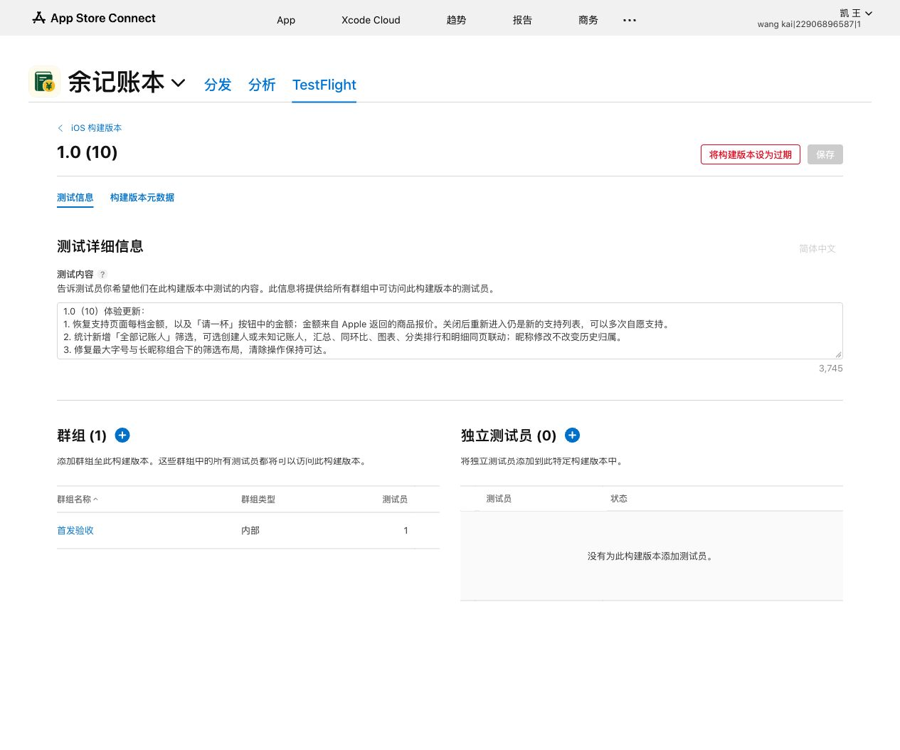
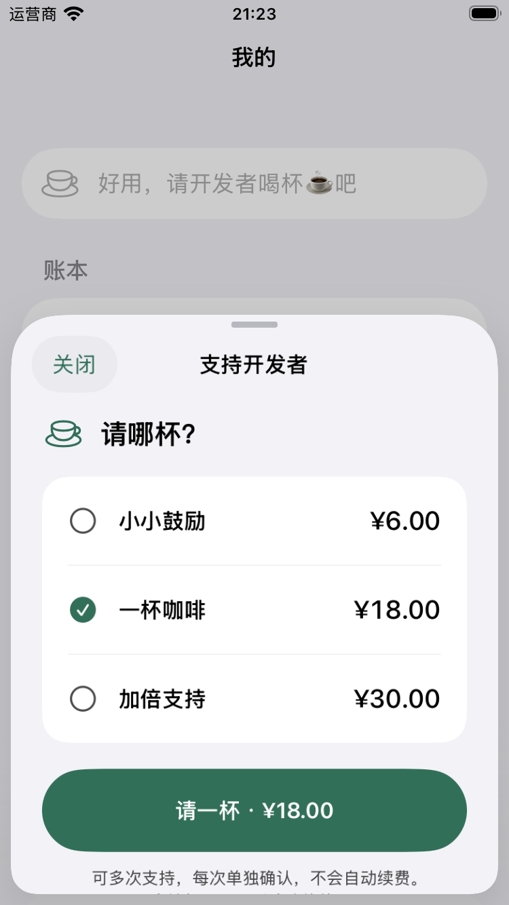
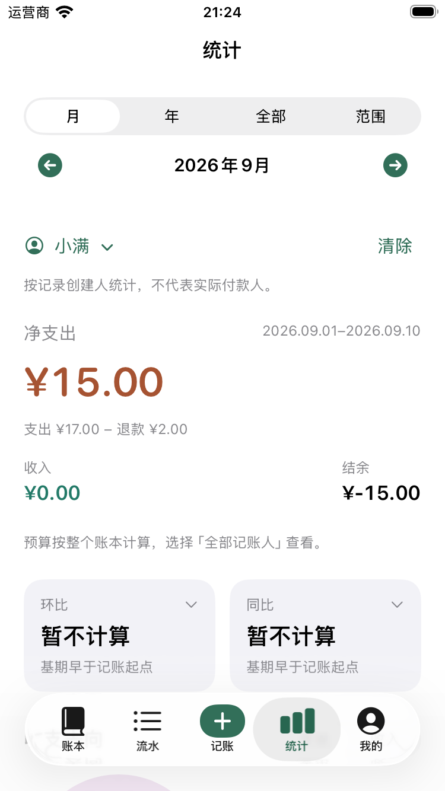
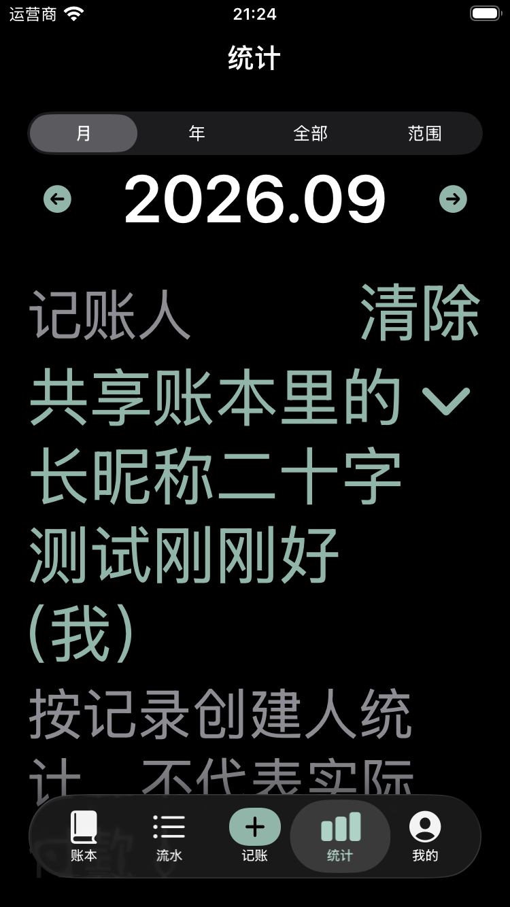

> 后续实机与材料状态已更新：构建 10 实际安装通过，App Privacy 已发布，App 与三档 IAP 已关联同一审核草稿；真实云异常与待完成项见 [最终阶段记录](cloud-final.md)。本文上传时的“手机仍为 9”等是历史状态。

# TestFlight 1.0（10）：恢复价格与按记账人筛选

2026-10-15。用户明确要求将恢复金额展示的版本重新发布到原内部 TestFlight 群组，并检查统计是否支持按人筛选。构建 9 的隐藏价格方案已撤回，本次不再采用。

## 交互与口径

- 支持页面恢复每档 Apple 本地化价格，选中后的按钮为「请一杯 · 金额」。每次打开是新的支持选择，不要求用户处理历史状态。
- 不把 USD 文本强改为 CNY，不根据设备语言或历史收据推算新交易价格。Apple 仍可能返回美元；恢复正常体验不等于目录/账号地区异常已解决。
- 统计原来仅展示记账人，没有人维度筛选。本版在时间栏下、统计内容首部增加原生「全部记账人」菜单：选人后汇总、月/年同比环比、月份柱图、分类饼图、排序、分类变化及明细使用同一个创建人过滤条件。
- 筛选以不可变 `authorID` 为键，改昵称、其他人编辑记录不改变归属。不推断实际付款人；说明明确写「按记录创建人统计，不代表实际付款人」。
- 历史 nil 作者单列「未知记账人」。菜单基于整个账本的有效收支/退款记录，时间切换不会让所选人员消失。没有记录的成员暂不列出；删除/离开的成员若仍有历史记录则仍可筛选。重名显示稳定序号，账号原始 ID 不出现在界面中。
- 退款按退款记录创建人计入，在退款发生日期汇总，分类取原支出；即使原支出属于另一个记账人，也不会丢掉退款分类。
- 分类下钻与明细仍同页；切换人清除分类下钻并重置明细分页。切换时间保留人，切换账本恢复全部。预算属于整本，选人时隐藏预算卡并提示切回全部查看，避免展示“个人预算”假口径。
- 不改流水、账本汇总、余额和预算默认查询；`StatsEngine.AuthorFilter` 默认 `.all`，只由统计页面传入选择。

## 验证记录

**1.0（10）已上传、处理完成并加入原「首发验收」内部群组（1 位测试员）。测试说明与群组刷新回读一致。** 手机最后回读为 9；10 的实际安装和真机体验待本人更新后核对。未提交 App Review。

| 检查 | 结果与范围 |
| --- | --- |
| 领域与状态 | `swift test` 176 通过、0 失败（Core 119 + AppState 57） |
| 原生主回归 | 92 通过、9 个真实云/清理 opt-in 用例跳过、0 失败；涵盖宿主状态、支持页、统计压力和新按人筛选 |
| 最终界面修复复验 | iPhone SE 4 通过，iPhone 18 Pro 2 通过，均无失败或跳过；共 4 个不同方法、6 次执行，不能相加为新增 6 条覆盖 |
| 大字号与长昵称 | SE / Pro 深色最大字号、20 字昵称，筛选与清除保持可达；正常字号与金额按钮也检查了原生截图 |
| Release | 最终签名归档成功；实际 App 14 项资源/配置门槛通过，严格代码签名检查通过；团队、Bundle ID、Production entitlement 匹配 |
| 分发 | Xcode Organizer 显示上传成功；ASC 构建 ID `47da7a06-1b90-47dc-af1a-42ded8053e3f`，原群组 `f8122c0b-5bc8-4b78-ab6c-c407840ab8f3`；说明与群组刷新回读 |
| 源码与依赖 | 最终 149 文件冻结快照；已测试 SDK 的 Package.swift + Sources 共 10 文件与归档使用的远端 checkout 字节相同 |
| 真机保护 | 更新前只读备份 Application Support 3 文件并生成哈希清单；本轮未安装覆盖手机、未购买、未写入或清理真实云账本 |
| 反馈与文档 | ASC 当前无崩溃反馈，不代表没有实际崩溃；当前规范、PRD、UI 与架构同步更新 |

主回归在最终布局修复前完成；修复只改变筛选 UI，之后针对最终源码完成 SE / Pro 定向复验，再重新归档并上传。初版同号归档未上传。最终 `.app` 二进制 SHA-256 为 `8a7e30e0183928e2e6b799ec03c81b2c06689c680c08ad2f2708225286baa038`。归档为开发签名，`get-task-allow=true`；Xcode 分发上传成功，但本次导出控件不可用，没有独立 IPA 重签文件验证，不能套用旧构建的 IPA 结论。

### 本轮发现并修复

初始实现把「记账人」、长昵称和「清除」挤在同一行。大屏功能断言能通过，但最大字号下昵称变成狭窄竖列；SE 上清除按钮不可达，真实失败结果保留在 `compact-repro.xcresult`。现在辅助功能字号将标题/清除置于首行，昵称菜单占下一整行，允许完整换行；不截断昵称、不限制用户输入，也未削弱可达断言。最终小屏与大屏复验均通过。

初次并行测试使用同一 derivedData 触发重复依赖解析，终止后结果包不完整；另一次诊断 `.xctestrun` 缺少测试框架环境导致 runner 启动失败。两者单独保留，不当作产品闪退或成功测试。之后使用冻结构建与独立 `.xctestrun`，完成后顺序导出结果；后续不要在同一测试产物目录并行启动依赖解析。

上述原生图来自隔离模拟数据，图中的人民币不证明真实 TestFlight 的 USD 异常已解决。

原始证据：`evidence/build10-20261015/`；私有冻结源码与工作树不等同于 Git HEAD。SDK 固定 `de43e661585e4e01d1aff2ae05dc3146bb32c686`。

## 发布前仍未关闭

1. TestFlight 的 USD 报价与历史 CNY 实际收据不一致，当前媒体与购买项目地区未核实（用户暂不便查看）。不反复要求登录/退出，不把 Apple 同类论坛问题当作已确认根因。
2. Production 不同账号基础共享、昵称同步和创建人/编辑人归属此前通过；真实双端同时离线、并发、撤销再邀请等完整异常矩阵尚未全部通过，本版不沿用模拟测试冒充真实云异常验收。
3. 最低声明 iOS 17，但当前机器可用原生运行时为 26.5/27；iOS 17 实际运行与 VoiceOver 听读尚未覆盖。
4. SDK 远端 CI 的账单限制、主仓大量未提交变更与干净 runner 的私有依赖配置仍是工程交付风险。保留本轮源文件/依赖/归档指纹，暂不合并或推送整棵工作树。
5. 大陆备案等待审核。最终 App Review 构建与三档 IAP 关联、审核材料需按最终候选再回读；本次仅内部 TestFlight，不提交审核或公开发布。
