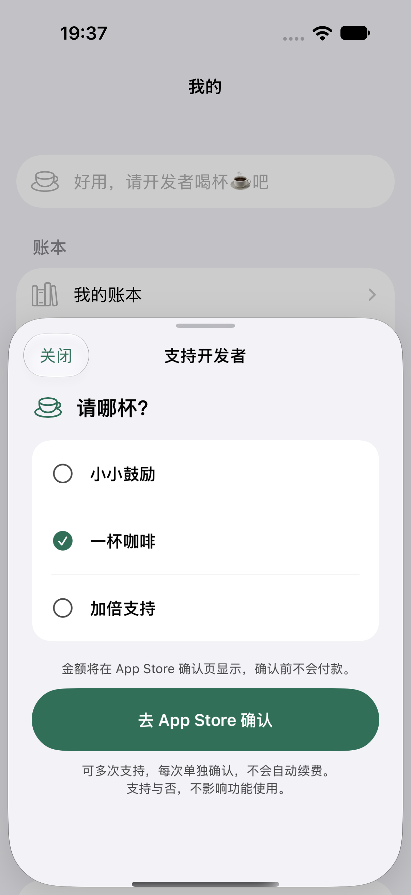

# 构建 9：TestFlight 金额由 Apple 系统确认

> 最新覆盖：用户真机体验后撤回构建 9 隐藏金额方案。9 已安装并通过选择页技术检查，但不能作为送审候选；本地已恢复明确价格展示，币种问题未解决。详见[撤回与修正记录](price-transparency.md)。以下构建 9 旧方案记录仅作历史证据。

2026-10-15，用户明确采用系统确认页兜底。**1.0（9）已签名归档并由 Organizer 上传成功；已加入原内部验收群组。手机最后确认仍为 8，9 的实际安装与本人系统确认尚待完成。** 没有提交 App Review，备案继续等待审核。

## 交互与代码

TestFlight/Sandbox 及未知分发收据下，三档仅展示名称，默认不选；选择后显示「去 App Store 确认」，说明「金额将在 App Store 确认页显示，确认前不会付款」。可见文案和 AX 一致，关闭重开为全新列表。识别到正式 App Store 收据时继续展示 Apple 本地报价。该决策避免展示已观察到的不可靠美元目录，不代表修复 Apple 目录服务，也不承诺系统确认页必为人民币。没有硬编码人民币、汇率换算、从旧交易推测价格或切换账号。

SDK 新增纯展示策略 `SupportPricePresentation`，默认 `.localized` 兼容其他宿主；不改底层 offer、核价、验签、去重、持久化后 finish 与当次防连点。余记在 `YujiDeveloperSupportSheet` 选择收据策略；Debug 预览覆盖必须同时有隔离 UUID。模型与 UI 细节已同步 PRODUCT、DESIGN、PRD、UI-SPEC 和 ARCHITECTURE。

- SDK：`de43e661585e4e01d1aff2ae05dc3146bb32c686`，已推送并更新 [PR #4](https://github.com/DMLayMan/ios-base/pull/4)，未合并、未 tag。
- canonical project.yml 与 Package.resolved 固定该提交，版本 1.0 / build 9；远端解析 10 个 SDK 源文件与本地通过测试的内容相同。
- App 当前工作树包含既有未提交实现；147 文件完整源码/资源/验证脚本已冻结到私有 source-complete.tar.gz，SHA-256 `debc3858941cbb155090a422743197f8352683c47e6adddea008cf3f26735189`。不能只凭旧 Git HEAD 重建此次候选。

## 实际验证

| 层次 | 本轮结果及范围 |
| --- | --- |
| App portable | 172 项通过：Core 115、AppState 57；不与原生重叠方法相加为独立覆盖 |
| App 原生 | 102 项中 93 通过、9 个 opt-in 真实云/清理专项显式跳过、0 失败；其中 UI 27 = 支持 14 + 昵称 2 + 发布回归 11。实际 xcodebuild 退出 0 |
| SDK | 48 个 Swift 模型通过；独立 consumer、relay 16、发布策略 4、TypeScript、dry-run、安全检查与 iOS Release 编译通过 |
| SDK 原生 | Pro 全部 11 项通过；SE 同一批二进制两项新动线专项通过。包括本地 StoreKit 交易、最大字号深色、完整按钮边界、关闭重开；不等于真实 Apple 支付 |
| 人工视觉复核 | 已查看 Pro/SE 普通、最大字号深色及余记实际宿主截图；长按钮换行完整，支持说明和退出入口可达 |
| 归档 | Release 签名归档成功；14 项实际资源/配置检查通过，严格签名、团队 7S626H9YL4、指定容器及 Production 核对通过 |
| 分发 | Organizer 明确显示 Yuji 1.0 (9) uploaded；Apple 构建 ID 5434b263-d602-456b-971a-c5c914e03e6e。已处理并加入原“首发验收”内部组（1 位测试员），测试说明已保存；实际安装待本人完成 |
| 本地分发 IPA | CLI 导出仍报 No Accounts / 无本地 Distribution 证书，Organizer 导出按钮在两个目录均禁用。未取得本次本地 IPA；归档为开发签名，不能把 get-task-allow=true 冒充最终分发权限 |
| 远端 CI | 新 run 38728984622 未正常执行，Relay annotation 明确为 GitHub 账号计费/额度拦截；没有规避或改计费 |
| 文档 | 8 份当前文档、97 个本地链接、92 张图引用检查通过；不替代内容或真实服务验收 |

原始失败保留：新模拟器 StoreKit 空目录、Pro 部分按钮可点击但尚未全露出的测试定位错误，以及中断未形成完整 xcresult 的批次。确认目录已注册、纠正滚动停止条件后用冻结二进制定向复核；未削弱边界断言。两个初始宿主/SDK 中断不是通过证据。详见 SDK 的 support-price-confirmation-2026-10-15.md。

## 发布材料

- 商店描述和审核备注增加可选 iCloud、昵称、创建人归属及确认金额动线；保存后刷新比对。三个 IAP 备注更新同一规则，人民币当前价分别回读 ¥6 / ¥18 / ¥30；未改价格或销售范围。
- 三档 IAP 的审核图均替换为下方当前原生支持页，图片处理完成后刷新回读到 Apple CDN 的 1206 × 2622 图片，备注也逐项回读包含截图来源说明。上传中的 blob 预览及“正在处理”不算保存完成；本轮曾遇到保存/加载延迟，最终三档均已核实。没有点击“添加以供审核”。
- 隐私 canonical 与实际包内一致。仅两页静态网站获授权并更新至 Pages 分支，提交 `cf89b6bbbda63a1a3b0c7890e990be212b54597d`；Pages built，匿名 HTTPS 回读与本地两文件逐字节相同。内容包括昵称、共享参与者、支持交易字段和新支付动线。
- [公开隐私页](https://dmlayman.github.io/iOS-accounting-app/privacy.html)、[支持页](https://dmlayman.github.io/iOS-accounting-app/support.html)。公开分支仅两文件，未推送 App 脏工作树、用户账本或支付收据。

## 尚未关闭的门槛

1. 9 的实际 TestFlight 安装、新界面、一次系统金额查看后取消，以及前后账本/收据回读；手机离线，已向本人请求连接。此前购买已通过，不需要再次购买。
2. 原 8 已完成真实 A/B 昵称、双向改名、新增归属及跨用户编辑；真实云异常矩阵的离线并发、撤销再邀请/退出、昵称只读与离线补发仍单列，不用本批模拟器跳过替代。
3. iOS 17 最低版本实际运行、人工 VoiceOver 仍待；当前本地运行时为 iOS 27。保留已知门槛，不宣称全机型验收。
4. App Privacy 最终发布、主版本最终选择及首次 IAP 关联、备案号及送审前最终人工确认。三档 IAP 审核图已与当前支持动线对齐；五张商店核心功能图来自此前批次，送审前仍需核对与候选的一致性。当前商店版本此前选中旧构建 4，不应直接送审。
5. App 候选源码需要经过完整范围检查后形成可复现 Git 提交；当前仅 SDK 修复和批准的静态网页已推送。SDK CI 计费问题未消除。

私有证据在 evidence/payment-currency-20261015/：归档、源快照、包检查、102 项原生结果、商品目录截图、后台 readback、公网页面和上传凭证。真实个人数据不入公开仓库。iPhone 使用独立无 AUT 安装路径的 runner，后续不得用普通 XCUITest 覆盖 TestFlight。

### 真机验收准备

构建 9 的独立 runner 已编译，预检确认无 `UITargetAppPath`、无 Yuji.app 安装依赖，仅 activate 已安装 App；不点击购买按钮、不修改账本或账号。待手机连接并完成 TestFlight 更新后，检查帮助页版本、三档 AX/可见金额隐藏、系统确认提示、完整按钮边界、关闭重开的默认未选状态。此处只是准备通过，尚未执行真机测试。

证据：`driver9-preflight.json`、`driver9-build.log`、`iap-review-build9-readback.json`、`iap-review-build9-saved.png`。私有运行清单 `.build-currency-20261015-driver9/Build/Products/Currency-build9.xctestrun`，方法 `DistributionInspectionTests/CurrentPriceUITests/testBuild9ConfirmationChooserWithoutPurchase`。先备份再运行，之后回读；本人查看 Apple 系统金额并取消另作为独立步骤。

## 19:54 发布后台补充

构建 9 测试说明首次被 Apple 以无效字符拒绝；移除咖啡 emoji 与箭头后保存成功，群组关联后刷新回读。未经后台实际保存回读，不能将输入完成计为材料完成。没有新增测试员或对外测试组。

## 原生界面

来自当前宿主冻结源码的原生隔离测试，1206 × 2622；不包含个人账本或账号。它证明界面呈现，不充当真实 TestFlight 系统付款凭证。
