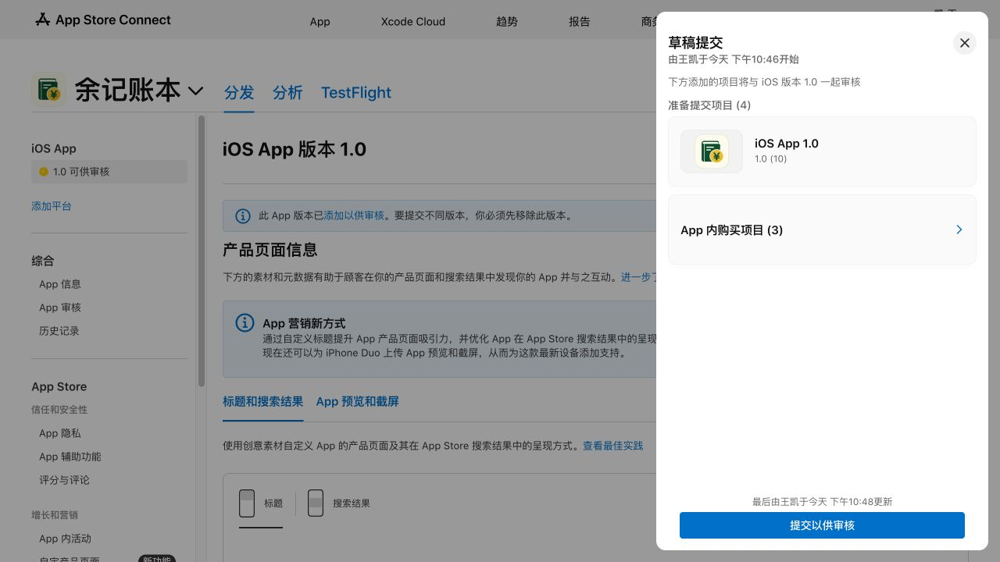

> 2026-10-16 最新：[共享退出修复与构建 11](cloud-resume-2026-10-16.md)。新私有邀请接受、修复后的真实成员退出、本地副本与重新加入已通过；统计人员筛选实测通过。构建 11 已加入原 TestFlight 内部组，手机升级待核对。下方构建 10 的待重邀/退出描述为历史状态，以最新报告和 validation-status.json 为准。

# 构建 10：真实云异常与发布材料复核

更新于 2026-10-15。本报告覆盖已安装的 TestFlight 1.0（10）及独立 Mac Production 成员测试端；不代表已提交 App Review。备案按用户要求继续等待。

## 范围与数据保护

只操作用户授权的现有 QA 共享账本，使用既有两个不同 iCloud 身份与已接受的精确 CloudKit zone。手机接管前有 5 笔记录，其中包含用户本次体验新增的记录；全部作为不可修改基线。新增测试记录使用独立 operation ID。每阶段验证既有记录逐字段相同、Mac 正常数据库逐字节不变。

原始账本、身份、私有邀请、日志及截图放在 Git 忽略的 `evidence/cloud-final-20261015/`，不提交公开仓库。未删除、恢复或覆盖用户账本，未操作付款，也未切换系统账号。

## 当前已验证

| 场景 | 证据与边界 |
| --- | --- |
| 手机实际版本 | 设备安装信息和 App 帮助页均为 1.0（10）；独立 runner 不安装或替换余记 |
| 统计记账人筛选入口 | TestFlight 原生 UI 检查通过；统计算法与小屏布局回归见构建 10 交付记录 |
| B 暂停同步后新建 | 本机持久化一笔测试支出；独立重启保留 pending；真实远端尚未出现，恢复同步后手机读到同一记录 |
| A 真实断网 | 用户关闭蜂窝/Wi-Fi 后，运行中的独立验收工具观察真实 CloudKit 网络错误；新建一笔、强制关闭再打开仍显示；磁盘 cached 7 笔、base 6 笔，修改待上传 |
| A 恢复联网 | 实际同步成功、issue 消失、cached 与 base 一致；旧 5 笔逐字段未变 |
| 同笔并发修改 | B 暂存版本、A 在 TestFlight 修改同一笔新测试记录；真实服务端冲突被保存，B 重启仍有 incoming；解决时保留 B 的独立未同步副本，采用远端 A 版本 |
| 只读与恢复写入 | A 通过系统成员页调整 B 权限；真实 B 端只读写入被拦截、业务数据不变，恢复后实际编辑到达云端；仍保持原创建人和最终编辑人 |
| 撤销成员 | A 原生系统页撤销唯一成员；B 实际无法继续写入，成功保留本地副本；A 原账目未变。旧链接返回 Stale short token，新邀请已准备但 B 接受待新链接 |
| 保存成功但回执丢失 | 真实 CloudKit 已保存，测试适配器故意在返回处抛 offline；本机 pending 保留、云上仅有一次操作；重启重试后 pending 清除、无重复。此项是注入回执丢失，不能称真实断网 |

恢复回执后重启重试去重、只读写入拦截、恢复权限后实际编辑并到达云端已通过。撤销成员后 B 冻结写入并保留本地副本已通过，A 旧 5 笔未变。移除唯一成员导致旧邀请失效（Apple 返回 Stale short token）；手机重新邀请原 B 账号成功，等待本人转交新私有链接，再完成 B 接受、主动退出与最终恢复。

## 失败与纠偏保留

1. 首次断网时，iOS 拒绝启动独立 runner，提示开发者证书不受信任；测试体未执行、没有新增记录。联网后先启动 runner，等用户再次确认断网后写入本轮唯一 gate，再执行实测。没有修改信任策略或卸载 App。
2. 用户首次回复“离线新增成功”，回读未找到新数据；再次核对后用户明确刚才没有新增。差异已澄清，不记为 App 丢失数据，也不以最初回复认定通过。后续真实自动新增、冷启动与磁盘结果才是本报告的离线依据。
3. 当前 Xcode 下载 iOS 17.5 返回不可用，最低 iOS 17 的实际运行仍待另一可用环境；不能用 iOS 26/27 通过替代。

## 发布材料

- 商店描述、App 审核备注已加入记账人筛选，并移除已撤回的“隐藏 TestFlight 金额”说明；刷新回读一致。
- 三档 IAP 审核备注与截图已更新。截图来自当前原生界面和隔离本地 StoreKit 目录；明确披露来源，不当作真实 TestFlight 人民币目录证据。
- 本体人民币价格为 ¥0.00；唯一供应地区为中国大陆，Mac 与 Vision Pro 的供应复选框未选中。
- 5 张新商店截图来自当前 Release 正常入口与合成数据，1206 × 2622，未经图像改写；2 条拍摄测试通过。后台回读 5/10，版本草稿改为构建 10，保持手动发布。
- 公开隐私/支持页匿名 GET 成功，与当前 Pages 提交 `7c3ffd2319c0c59f9e613ec9fe7b77f989fec859` 逐字节一致。政策正文 16 段与 canonical 一致，归档中的政策也与 canonical 一致。
- 用户明确授权后 App Privacy「未收集数据」已发布，后台发布状态回读确认。另已把三档 IAP 与构建 10 放进同一份审核草稿，后台回读共 4 项且显示可供审核；没有点击最终「提交以供审核」。

## 发布剩余门槛

真实云异常剩余阶段、打赏目录 USD 与真实 CNY 交易差异、最低系统实跑、备案结果与最终 App Review 授权分别回收。SDK PR #4 的远端 CI 仍 failure；本地测试通过不能替代远端成功，也未修改 GitHub 计费配置。

## 首次 IAP 关联与草稿边界

Apple 当前流程将加入草稿与提交审核分开。三档消耗型商品已加入同一草稿，再关联 iOS 1.0（构建 10）；后台显示「准备提交项目 (4)」，最终提交按钮可用但未点击。详见 [当前官方流程](https://developer.apple.com/help/app-store-connect/manage-submissions-to-app-review/submit-an-in-app-purchase/)。这消除了首次 IAP 尚未关联的材料项，不代表备案、币种和功能门槛都已通过。

验收驱动失败也保留：初次生成移除成员清单误用 v2 结构，实际是 v1，未执行测试；改为读取实际结构后通过。移除唯一成员后系统弹层会自动关闭，旧的「完成」步骤因按钮不存在安全停止，随后原生根页重邀成功。旧链接接受测试失败是服务端撤销的实证，不当作新邀请接受通过。

## 数据回读与继续条件

A 端重新邀请后再次备份，13 项保护检查均通过：旧 5 笔逐字段保留、其他流水/账本/账户/分类/草稿/设置不变，旧 Development 绑定与缓存不变，支持支付文件逐字节一致；计数仅新增本轮 A 端那一笔。当前 QA 共 8 笔，B 的正常 Mac 数据库每阶段逐字节校验。

已完成场景按上表报告，不将同一个测试方法的多阶段/重跑次数累加成独立功能覆盖。新邀请的转交尚未完成，故不能声明重新加入、主动退出或最终双端恢复均通过。手机保持邀请成功页等待本人操作，不会重复新增、支付、卸载或切换账号。新链接只存私有 evidence，不写入公开材料。
