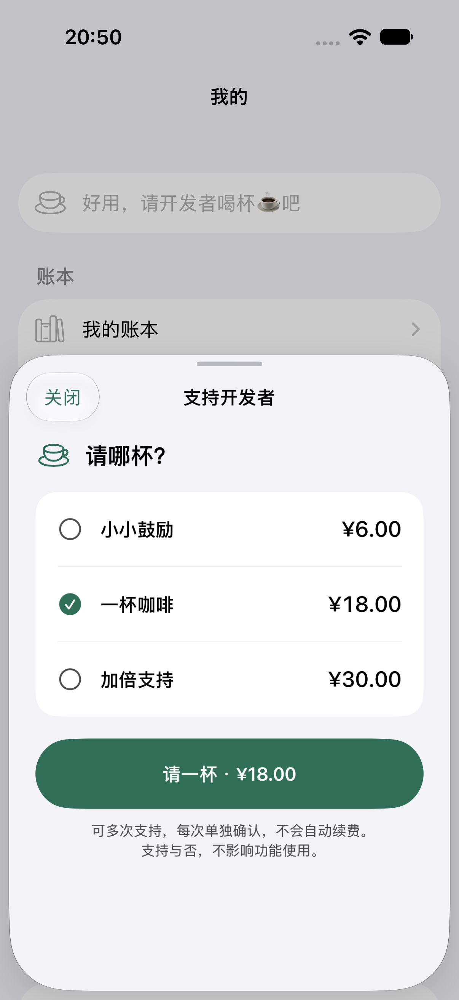

# 支持页价格透明：撤回构建 9 兜底

> 后续更新：用户明确要求恢复价格版重新打 TestFlight，已完成 **1.0（10）** 上传并加入原内部群组。恢复展示与新统计筛选验证见[构建 10 交付](build10-delivery.md)。手机最后回读为 9，10 待安装；真实 USD 报价异常未关闭。

2026-10-15 晚，用户实际体验后明确否定隐藏金额与“去 App Store 确认”。该决定覆盖此前文字审批；功能测试通过不能代替用户体验认可。构建 9 不再作为送审候选，不再请本人为被否定的动线继续付款/取消测试。

## 已发生与未发生

- 手机实际安装 1.0（9），设备清单、帮助页、真实 TestFlight 返回标识与独立 runner 均有证据；支持选择/关闭重开 1 条真机测试通过。此证据只证明旧方案实现，不证明方案适合发布。
- 升级前后所有业务/昵称字段相同，仅 cloudLinks 的 lastSync/version 更新；3 条购买收据内容相同，JSON 编码字节变化，不能声称升级前后整个收据文件字节相同。选择页验收前后收据与邀请文件字节相同。私有证据位于 evidence/payment-currency-20261015/live-build9/。
- 人工系统确认/取消尚未执行便撤回，取消观察 runner 只编译未运行。没有本轮新支付、账号切换、删除/恢复账本或 App Review 提交。

## 修正后的产品契约

1. 金额是用户选择支持档位前的必要信息。档位和按钮都展示 Apple 返回的本地金额，用户点“请一杯 · 金额”后在 App 内完成 Apple 原生确认；不是跳去 App Store 应用。
2. 余记统一使用 localized 展示，移除按收据环境隐藏金额的分支及旧 Debug 开关；不改变交易模型和验签落盘。
3. 不能硬编码 ¥6/¥18/¥30 代替运行时报价，不能把 $ 替成 ¥、套汇率或从历史收据推断当前价格。
4. 测试环境币种异常单独定位、标记未通过，不能靠改变正常用户动线关闭问题。界面恢复不等于根因修复，也不推断正式 App Store 必然正常。

## 本轮一手核对（2026-10-15）

- [Apple displayPrice](https://developer.apple.com/documentation/storekit/product/displayprice)：使用 StoreKit 给出的本地化商品显示价格。
- [Apple 官方论坛同类问题](https://developer.apple.com/forums/thread/845478)：开发者报告 TestFlight 商品 USD、付款确认本地币种；Apple DTS 回复仍在调查。部分开发者称同一归档 Development 正常，不能直接推出余记同根因或 Production 正常。
- [另一份最小原生复现报告](https://developer.apple.com/forums/thread/847397)：作者记录 SK1/SK2 都会出现目录与系统页地区不一致；因此没有证据支持盲换 SK1 必能修复。
- [Apple TestFlight 购买测试指引](https://developer.apple.com/help/app-store-connect/test-a-beta-version/testing-subscriptions-and-in-app-purchases-in-testflight/)：TestFlight 使用测试购买环境；Sandbox 配置与实际生效购买身份需要区分。

研判：现有直接 StoreKit 查询、付款前重新取价和 storefront 变更监听已存在，既有真机重复查询仍美元，不能宣称“加刷新”即可修复。余记有效媒体购买地区尚待核实；用户本轮暂不方便查看，不继续索要或变更账号。Apple 反馈草稿已存在，尚无发送授权，也未发送私人日志。

## 后续门槛

恢复版完成定向原生验证后，依据用户后续明确要求已分发构建 10 供体验；这不等于报价一致性验收或正式送审。已安装 9 不会自动被本地源码替换，需要 TestFlight 更新。正式送审前必须处理报价一致性、当前 App/IAP 文案截图与最终构建一致性；后台三档图/说明上次回读仍为已撤回的 9，明确阻止直接送审。公开两页已移除绑定此临时交互的陈述，交易隐私字段不变。

## 恢复版验证

本地宿主两条定向原生 UI 均通过、0 跳过/失败：旧开关存在时仍显示价格/按钮/AX，关闭重开无预选，以及取消回到可选择状态。仅验证展示和本地模拟取消；不是 TestFlight 币种或真实系统取消通过。构建 9 的 1 条真机旧方案检查单独保留，不与此恢复版合并计数。

此图来自隔离模拟器测试目录，人民币测试价格不能充当真实 TestFlight 报价修复证据。后续恢复版已进入构建 10，见文首最新记录。
