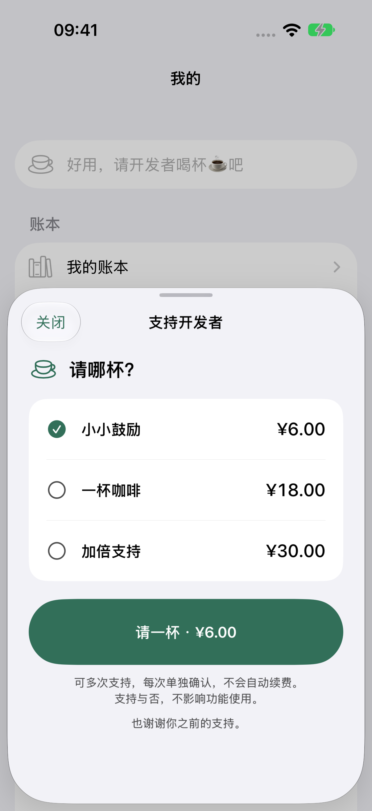
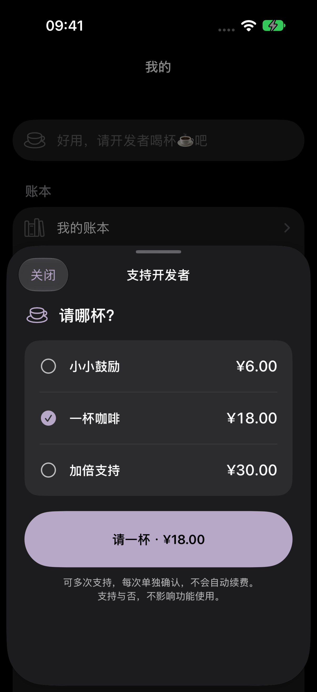
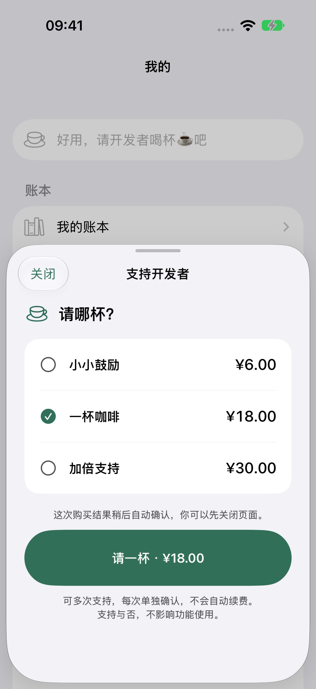

> 最新回收：本人登录后完成两笔18/CNY的Sandbox交易，验签落盘且保留原收据；进入/重开仍USD，价格展示未关闭。见 [构建7真实结果](build7-iap-hang.md)。

# 可重复打赏与清爽入口修正

2026-10-15，用户确认构建6仍显示旧“暂时无法确认购买结果”，明确要求不管理历史状态、每次进入直接显示最新金额并可重复打赏。

## 变更

- 删除检查购买状态、Apple 历史记录、手动解除提示动线；旧 unresolvedProduct 不再锁住入口，不删除已验签收据。
- 打开→最新三档金额（无预选）→主动选档→Apple 系统确认；当次核价/系统调用防连点，取消安静返回。
- pending/unknown 仅列表内轻提示，重开/冷启动回到全新选择；不自动付款、用户可主动另发一笔。
- 当前交易验签+落盘后自动关闭并感谢；历史迟到确认只后台补录，不能关闭新面板或改变新选项。
- 价格仍由 Apple 当前 Storefront 返回，不强制将美元改成人民币。账本、100笔邀请频控、收据目录与 scope 保持。

## 当前验证范围

SDK 已固定远端 4f573f2fee49e30626ef702af0db72eb6e71ebac，原 [PR #4](https://github.com/DMLayMan/ios-base/pull/4) 已更新，未合并/打 tag。最终43条Swift与7条原生StoreKit harness均通过、0失败/跳过，Release编译及消费者、relay16条、发布策略4条、dry-run和audit（0漏洞）通过。

重点核对：同一商品两次主动购买为2笔独立交易；旧日志仍可读且不锁页；unknown关闭/重开和冷启动无历史提示；旧pending批准不覆盖新选择；旧回调在新一轮核价或付款中均不关闭新页；本机落盘失败不finish，可恢复重试。首轮7条UI也通过，最后补竞态保护后再次完整跑7条，不累加为14个覆盖场景。私有源哈希与最终测试源码逐项匹配。

余记swift test为113条Core＋48条AppState，0失败。宿主最终22条专项全部通过、0失败/跳过（13条支持UI＋6条邀请＋3条呈现依赖）。其中真实本地StoreKit多次支持均自动退出并显示感谢，旧批准不关闭新选择；未知/待批准重开与冷启动不锁页，深色与最大字号操作可达。canonical构建号7，远端SDK解析与实际本地验收代码逐项一致；归档、资源及严格签名/团队/Bundle/Production容器核对通过。手机现已实际7，入口/重开原生1条通过，但真人点击付款卡住，不将入口通过当作支付已修复。无再次支付、无QA清理、无App Review提交。

## 发布门槛

本地 StoreKit 模拟器与真实 Sandbox/TestFlight 分开记。新包应本人检查“打开即选金额、关闭重开/冷启动无历史锁、系统取消回列表”；真实再次购买只在本人明确操作时执行，不为验证重复打赏擅自发起扣款。

## 原生效果（隔离模拟器）

已人工复看浅色、暮紫深色与未知结果内联提示；用户真实账本未被这些测试访问。金额为测试商品配置，不证明真实 Storefront 为人民币。

## 运行与交付记录

- SDK：4f573f2，原PR #4已更新并回读匹配；远端新CI run38693970346的四项annotations仍明确为GitHub账号付款/额度而未启动，另有arm64排队提示，未更改计费或跳过检查。
- 余记22条专项首次启动被脚本的“双xctestrun清单”保护挡住（generic与最终arm64各一份），没有启动App或执行用例。随后明确选择最终arm64清单，单元宿主设置新隔离UUID，实际22条通过；保留准备失败，不当作产品缺陷或删除记录。
- 构建7冻结111个源码/资源/测试及验证脚本，tar逐项解包哈希通过；包含固定远端SDK的Package.resolved。相对6仅SDK引用/锁文件、当次完成事件接线、协调器说明、专项UI测试与构建号改变。
- 本人已解锁，Xcode明确显示1.0（7）uploaded，ASC列表回读7正在处理。实际分发IPA导出4,030,676字节，严格签名、资源、团队/Bundle/Production容器、get-task-allow=false均通过；SHA256为4274f9e0f87420662bf398878bde33c980092f328e8f3880d7dff2ab36a6be82。ASC已处理并加入原1人内部群组，说明保存后回读一致。本人、设备清单、原生帮助页均验证7；入口/关闭重开1条通过。随后本人点击付款卡住，取证见 [故障记录](build7-iap-hang.md)。不再要求核对历史/解除状态，不自动付款。
