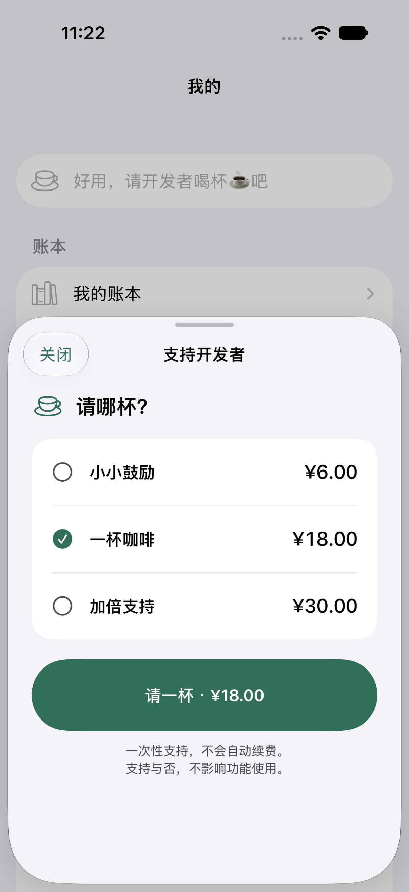
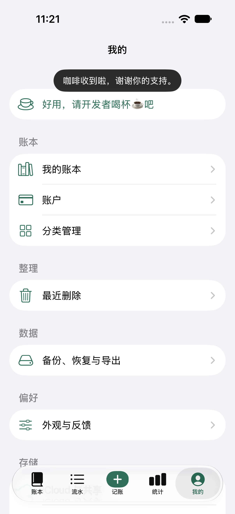
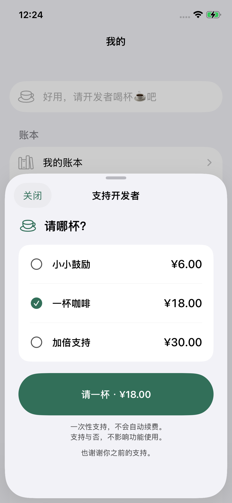
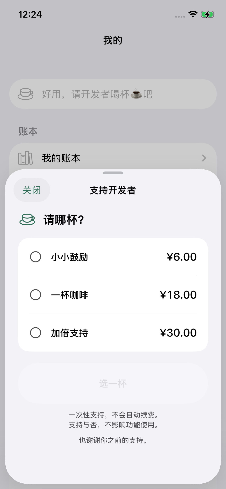

# 支付体验复审 · 2026-10-14

本次新版真实 Sandbox 验收已回收：用户对「¥6、Sandbox、自动关闭支持弹层、顶部感谢」的操作说明回复「测试没问题」；随后从正常应用目录读到新的一笔已核实 Sandbox 收据，金额 6、币种 CNY、产品为小小鼓励、未撤销。此前旧版不关闭/无感谢/美元价格的反馈促成以下修正。人工体验证据与新交易证据分别保留，自动观察用例的原始超时不改写为通过。

## 已确认的代码问题与修正

| 问题 | 影响 | 修正 |
| --- | --- | --- |
| 缓存商品未监听 Storefront 变化 | 沙盒登录改变地区后，页面可能保留旧价格 | 地区更新流清缓存并重新获取；前台和付款前再次核对 |
| 首次登录购买途中地区变化仍继续 | 用户之前看到的币种、金额可能与确认页不一致 | StoreKit `onStorefrontChange` 拒绝沿用旧地区，返回新价格后二次确认 |
| 成功阶段排在 `await finish` 后 | 收据已写入仍可能维持加载，确认反馈被网络拖住 | 签名核实和原子记录后先发出完成事件，再 finish |
| 感谢仅依赖购买页可见及内部状态 | 页面关闭、后台、回调先后变化可能没有用户反馈 | 生命周期持有完成事件；原页面确认，后台延至前台；去重和冷启动不重放 |
| 没有自动退出成功弹窗 | 完成后仍被弹层拦截 | 自动关闭，复用 App 的顶部提示，3.5 秒后消失 |

用户动线：主动选择 → 核对最新地区/金额 → Apple 确认 → 签名核实 → 本机原子记录 → 自动关闭、感谢 → finish。核对失败不会创建未决交易；购买后未知/待处理/记录失败不会假报成功或再次发起付款。打赏记录独立于账本，不生成收入、支出。

价格与地区遵循 Apple：[displayPrice](https://developer.apple.com/documentation/storekit/product/displayprice)、[Storefront updates](https://developer.apple.com/documentation/storekit/storefront/updates)、[购买中地区变更](https://developer.apple.com/documentation/storekit/product/purchaseoption/onstorefrontchange(shouldcontinuepurchase:))。中国大陆草稿 ¥6 / ¥18 / ¥30 不用来覆盖运行时的真实商品价格。

## 实现与兼容

支付核心在同级 `ios-base` 的 DeveloperSupportKit 修复；不把组件复制进 App。新增目录变化流、付款前核对状态、一次完成事件。宿主负责呈现、原页面感谢和前台时机。商品 ID、scope、目录及 journal schema 1 不变；收据金额/币种为可选字段，旧收据继续加载，不伪造历史金额。

App 的 `ios-app/project.yml` 已恢复 SSH 远端依赖，固定 `aaa646c95d472243507c3c1062d6eb77f25ada74`。组件 [PR #4](https://github.com/DMLayMan/ios-base/pull/4) 已创建并附到本任务，远端分支和解析后的源码与已验收组件一致。PR 尚未合并，远端 CI 因 GitHub 账户付款或支出限额未启动，不能宣称远端检查通过。

## 验证状态

- 旧代码先失败：价格变化仍购买、finish 等待时未进入成功；修复后模型测试 13/13 通过。
- 第一轮 App 原生回归 12/12 通过、0 跳过；人工查看截图发现顶部感谢与导航标题重叠，已下移到导航栏下方，最终三条关键路径 3/3 和邀请单元用例 6/6 通过；位置断言确认感谢位于导航栏下方，最终截图已人工复看。
- 组件独立 harness 4/4、Release 编译通过。首轮完整 make verify 在 npm audit 超时处退出 2；独立复核 audit 返回 0 漏洞。模型/relay/发布策略/打包/消费者检查均已通过。
- App 自身 Release 编译通过（未签名）；开发签名 1.0 (3) 已安装到 iPhone 12，云权限为 Development。真机两条回读用例通过：历史支持说明保留、重启不重播、原流水仍 1 笔、三档真实目录为 ¥6 / ¥18 / ¥30。
- 真机独立目录有 1 笔已核实 Sandbox 小小鼓励收据，无未决交易。旧版未记录 amount/currencyCode，因此旧交易具体扣款金额无法从这份日志回溯。正常个人账本与 2026-10-13 备份、安装前后及真机回读后均逐字节一致；购买日志升级前后也相同。
- 新版真实支付体验：用户回复「测试没问题」，新收据为 Sandbox / ¥6 / CNY、未撤销。新收据写在正常应用目录，隔离目录仍保留原先 1 笔；两个目录共 2 笔不同交易。无需再次付款；UI 成功由本人确认，自动观察窗口已先行超时，仍保留为超时。
- B 已由本人在独立模拟器登录获授权的 Mac 现有 iCloud，真实身份与 A 不同。Development 指定私有邀请、冷/热接受、双方新增、重复邀请、只读/恢复编辑、撤权及重新邀请恢复通过；权限改变由 SDK 发出，B 用实际 UI 核对，完整矩阵与 Production 仍独立待验。Mac 当前用户及其 iCloud 未切换，发布身份保持原样。详见[双账号验收](../icloud-delivery-2026-10-08/dual-account-acceptance-2026-10-14.md)。
- 不修改备案审核、Production schema，不提交 App Store 审核。

新版真实 Sandbox 反馈已准备 opt-in 真机观察用例：选择正式人民币 ¥6 商品后交给本人点购买与系统确认，测试只在购买期间等待感谢和关闭；成功后才核对流水数量。本次等待 300 秒没有捕获完成反馈，观察用例超时；随后回读仍为原先 1 笔收据，没有新增已核实交易。不能据此判断用户是否尝试或系统支付失败；随后用户确认测试正常，正常目录新增已核实 Sandbox 收据 ¥6/CNY。该人工路径已通过；原始自动观察失败保留，不能伪装成自动化通过。

## 正常启动后的测试数据边界

手工支付后的正常库新增了同账号自动发现的 Development 验收账本（3 笔），因此此时完整文件字节已不同。核对原账本、账户、分类、流水、草稿及当前选择均未变化；新增账本 ID 与已知云验收夹具完全一致，不能把这 3 笔当成支付产生的流水。此前隔离自测结束时字节一致的结论仍属于原批次，不能延伸到这次普通启动。

这是 QA 隔离范围的问题：本地 UUID 不隔离同账号同容器同环境的云 zone；正常启动会按产品规则发现已启用账本。A/B 快照和精确离线预览完成后，用户授权清理；真实 SDK 回读目标消失、其他 zone 不变。A 正常库、B 正常/隔离库已回收目标缓存；正常重启没有回流，原用户实体、设置、选择、其他云绑定和新支付日志保留。首次本地指纹拦截与最新三条清理用例的证据见[清理记录](../icloud-delivery-2026-10-08/test-fixture-cleanup-2026-10-14.md)。

## 避免后续踩坑

1. 金额来自购买地区，不来自设备语言；首次登录是地区变更场景，不能只测已登录的本地 StoreKit。
2. 测试「商品加载、取消、pending、核实收据、持久化、finish、用户反馈」各自的证据，不能互相替代。
3. 测试 updates 与 purchase 返回的不同顺序、finish 延迟、关闭后确认、后台后前台；仅测试同步成功返回会漏掉问题。
4. 成功提示由业务宿主承接；支付组件提供一次事件，不把宿主账本/导航塞入公共模块。
5. 桌面普通启动不继承测试进程的 UUID；回读收据时同时核对隔离与正常目录，不能因隔离目录没有新收据而要求重复付款。
6. 真实支付由用户确认。自动化不填写密码或确认系统付款；测试 UUID 与个人账本隔离，安装前后比对原文件字节。

## 实际原生效果

以下为 iOS 27 模拟器与本地 StoreKit，证明界面和完成反馈，不证明真实 Sandbox 币种或收据。

## 真机实际效果

以下是 iPhone 12 的真实 StoreKit 目录及已支持历史，没有启用 SKTestSession。

## A 端共享准备

真实 CloudKit 的私有 CKShare 已保存，系统共享控制器显示拥有者、与更多人共享、共享选项和停止共享；1 条探针通过且截图人工复看，最终断言明确检查“与更多人共享”存在且可点击，避免仅以弹窗覆盖原按钮来判断成功。该系统面板截图属于早期只准备分享的批次；后续已完成指定成员、真实 B 接受、双向新增、权限和撤权，详见双账号验收记录。系统页面目前用通用文档缩略图，后续可提供账本/App 缩略图提升识别，属于视觉待优化项。
